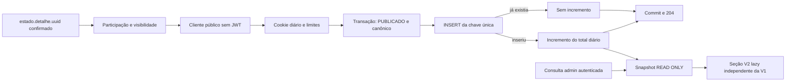

# Dashboard V2.1 — arquitetura consolidada para aprovação

**Planejamento, sem implementação.** Revisão de 26/10/2026, America/Sao_Paulo, sobre HEAD `18e79d5`, com árvore inicialmente limpa e V1 já incorporada. Este documento substitui como proposta vigente a cópia local em `docs/dashboard_v2_1_arquitetura_metricas.md`, preservada sem alterações. `backend/docs/` já possui exceção no `.gitignore`; nenhuma regra de ignore foi modificada.

## 1. Escopo e fases

| Etapa | Entrega proposta | Fora da etapa |
| --- | --- | --- |
| V1 existente | Acervo administrativo, todos os status, conservação, regiões e categorias | Não substituir API, componentes ou regras de contagem |
| **Fase 1 da V2.1** | Visualizações qualificadas por patrimônio, cookie diário opcional, deduplicação, séries temporais e por região, cobertura observada e retenção | Favoritos globais, login de visitante, IA e selo público |
| **Fase 2 da V2.1** | Favoritos globais ativos com adições e remoções, preservando favoritos locais em todos os contextos | Sincronização entre dispositivos como se fossem uma pessoa; histórico de favoritos sem projeto próprio |
| Futuro independente | Gemini, score de tendência e selo público “Em alta”, conforme [planejamento de tendências](../../frontend/planning/tendencias_culturais.md) | Nenhum SDK, chamada externa, chave ou selo implementado nesta fase |

Reaproveitar Express 5, Prisma 7, PostgreSQL 17, React 19, Recharts e CSS Modules. Não introduzir fila, Redis, fingerprint ou plataforma externa de analytics na Fase 1. Os prazos, parâmetros de proteção e critérios de qualificação abaixo são propostas a aprovar antes da implementação.

**Universos diferentes:** a V1 continua contando registros administrativos de todos os status, inclusive legados. A V2 coleta somente visualizações de patrimônios canônicos **PUBLICADO no momento da aceitação**. O histórico aceito permanece quando o bem é arquivado posteriormente e deve exibir seu status atual no admin. Os 36 registros descritos na auditoria V1 não são uma constante nem um denominador de audiência. Não reutilizar `contagem.total` da V1 como total de acessos, visitantes ou participantes.

## 2. Integração com o código real

| Arquivo atual | Uso na arquitetura consolidada |
| --- | --- |
| [AdminDashboard.jsx](../../frontend/src/features/admin/pages/AdminDashboard.jsx) | Preservar saudação, atalhos, carregamento/erro, contagens, legados e estados V1. Acrescentar futuramente seção/aba V2 com estado, período e falhas independentes. A falha V2 não impede V1. |
| [GraficosDashboard.jsx](../../frontend/src/features/admin/components/GraficosDashboard.jsx) | Manter os quatro gráficos e o contrato `dados`. Novo módulo V2 lazy ao lado dele; reutilizar Card/Chart locais sem duplicá-los ou extrair componentes V1 só por estética. |
| [dashboardApi.js](../../frontend/src/services/dashboardApi.js) | Manter `buscarDashboard(signal)` e a leitura de `data.data`. Acrescentar função administrativa `buscarMetricasDashboard(filtros, signal)`, usando o cliente autenticado existente. |
| [dashboardService.js](../src/services/dashboardService.js) | Manter `getDashboard()` e seus campos. Serviço V2 separado, seguindo RepeatableRead + READ ONLY nas leituras administrativas. Nenhuma escrita dentro do serviço V1. |
| [dashboardRoute.js](../src/routes/dashboardRoute.js) | Preservar GET `/api/admin/dashboard`. A rota V2 `/metricas` também exige `authenticate` e `authorize("ADMIN", "EDITOR")`. |
| [PatrimonioDetalhe.jsx](../../frontend/src/pages/PatrimonioDetalhe/PatrimonioDetalhe.jsx) | Instrumentar somente `estado.detalhe?.uuid` confirmado. O `item` atual pode vir provisoriamente de `patrimonios.find(...)`; nunca usá-lo como gatilho. |
| [FavoritoButton.jsx](../../frontend/src/components/FavoritoButton/FavoritoButton.jsx) | Hoje consumido por `Inicio.jsx` e `features/mapa/PlaquetaCard.jsx`. A Fase 2 precisa alcançar todos os contextos, não somente detalhe. |
| [useFavoritos.js](../../frontend/src/features/favoritos/useFavoritos.js) e [favoritosStore.js](../../frontend/src/features/favoritos/favoritosStore.js) | Preservar `useSyncExternalStore`, estado por slug, evento storage, limite 500 e funcionamento em memória. O coordenador global futuro observa intenções comuns dessa camada. |
| [services/api.js](../../frontend/src/services/api.js) | Usa JWT, refresh e tratamento de sessão administrativa. **Não importar nem reutilizar na ingestão pública de métricas.** |
| [identidadeEditorial.js](../src/utils/identidadeEditorial.js) | Reutilizar a política canônica e a exclusão dos dois legados, inclusive se algum deles vier a estar PUBLICADO por erro. |

O código atual e o [relatório final V1](../reports/dashboard_v1_final.md) são as referências. O guia antigo `backend/docs/dashboard.md` descreve outro formato de resposta e regiões em Localizacao; isso não corresponde ao `dashboardService.js` atual. Esta proposta usa `Patrimonio.regiaoId` e `RegiaoPatrimonio`, sem recuperar aquele contrato antigo. A correção geral de documentação antiga não faz parte desta entrega.

**Correção sobre exclusão:** não há DELETE físico de patrimônio nas rotas atuais. Existem criação, leitura, edição, publicação e **arquivamento**, além de DELETE de mídias/documentos. A proposta não cria DELETE de patrimônio. As FKs de métricas com Restrict são proteção para eventual manutenção futura, não alteração de uma rota de exclusão já existente.

## 3. Fase 1: o que contar

Uma visualização qualificada requer participação habilitada, detalhe público confirmado, aba visível e pelo menos **2 segundos** de visibilidade após a confirmação. Reiniciar ao trocar UUID; pausar enquanto oculta; cancelar em erro, desmontagem, recusa ou troca de rota. Não contar o GET, prefetch, card, marcador de mapa, imagem, mock de desenvolvimento ou preview administrativo. Não acumular tempo enquanto `estado.detalhe` é null.

O futuro hook em `DetalhePorSlug` recebe a expressão `estado.detalhe?.uuid` e os sinais de elegibilidade, sem fallback para `item.uuid`, slug, número ou ordem. Hooks devem ser chamados incondicionalmente, antes de retornos antecipados, e tratar UUID ausente internamente. A referência do efeito é o UUID confirmado, não a identidade do objeto retornado após edição. Um novo fetch do mesmo bem não gera uma nova visualização diária. No frontend, suprimir coleta em contexto administrativo conhecido, preview e edição; a coleta pública sem JWT não pode provar que um visitante anônimo não é membro da equipe.

Na Fase 1, iniciar também o bootstrap do cookie apenas quando houver essa confirmação e adesão; não emitir credencial analítica ao montar Home, catálogo ou item provisório. Ainda assim, uma credencial pode ser emitida e a pessoa sair antes dos 2 segundos: isso continua sendo zero visualizações.

Deduplicação do servidor: **identidade diária emitida + patrimônio UUID + dia**. StrictMode, reload, abas e retries com a mesma identidade não geram segundo incremento. O dia é calculado no servidor em `America/Sao_Paulo`; timestamps operacionais usam UTC. A série mensal soma visualizações qualificadas diárias, não pessoas únicas no mês.

**Não há indicador “navegadores que visualizaram” baseado em emissão de cookies.** Emitir/reutilizar cookie não conta conteúdo visto. A Fase 1 não propõe audiência única global: a chave persistida será específica de patrimônio/dia, sem permitir deduplicar pessoas entre bens. Se emissão de cookies for monitorada tecnicamente, deve chamar-se “emissões de credenciais”, permanecer operacional e nunca alimentar gráficos de audiência.

Sem login, apagar cookie, usar outro perfil/dispositivo ou obter duas identidades pode gerar contagens adicionais. A garantia é por credencial, não por navegador físico ou pessoa. Coordenar bootstrap entre abas, reutilizar cookie válido e só enviar eventos depois de receber sua confirmação reduz a corrida inicial; não elimina manipulação por clientes maliciosos.

## 4. Participação, cookies e cliente HTTP público

Participação de analytics desabilitada até escolha explícita. Navegação e favoritos locais continuam disponíveis sem cookie analítico e sem conta. Guardar a preferência de forma versionada; se a preferência não puder ser persistida, manter no máximo a escolha da sessão, sem criar participação silenciosa na próxima visita. Propor respeitar GPC como não participação e não usar fingerprint/IP para compensar bloqueio de cookies. O texto e a política de dados precisam de aprovação do responsável; esta arquitetura não é um parecer jurídico.

Cookie diário contendo token criptograficamente aleatório, dia, finalidade e assinatura; sem informação editorial ou pessoal. Validade fixa até o fim do dia de São Paulo, não 24 horas deslizantes. Chaves de assinatura/HMAC são segredos próprios, independentes de JWT e nunca `VITE_*`. Todas as instâncias usam a mesma chave ativa do dia. Validar assinatura, dia e finalidade; não aceitar token velho como evento retroativo. Para deduplicar, derivar `HMAC(chaveDoDia, token + patrimonioId)`, com codificação inequívoca dos campos. Não persistir token cru nem ligar visualizações à identidade de favoritos da Fase 2.

Em produção HTTPS: HttpOnly, Secure, SameSite=Lax, Path=/ e sem Domain; prefixo `__Host-` se aplicável. No desenvolvimento HTTP loopback, usar nome distinto sem prefixo `__Host-`, Secure desabilitado **somente nesse modo explícito**, mantendo HttpOnly/SameSite. Testes de Secure/prefixo devem ocorrer também em HTTPS. Opt-out elimina cookie e para envio; por ser credencial diária sem cadastro central, uma cópia maliciosa do token pode continuar válida até expirar. Não prometer revogação global instantânea nem apagar totais agregados ao expirar cookie.

Criar futuramente `frontend/src/services/metricasPublicasApi.js`, usando `fetch` ou instância Axios independente, com base relativa `/api`, timeout, AbortSignal, JSON e credenciais same-origin. Não importar `api`, não ler sessão administrativa, não anexar Authorization e não renovar JWT nem redirecionar em 401. Emite somente requisições às rotas públicas de métricas. O cliente administrativo V2 continua separado, em `dashboardApi.js`.

Proteger mutações por Origin exata, JSON e cabeçalho próprio (`X-Portal-Metricas: 1`), rejeitando origens ausentes/nulas em chamadas de navegador neste contrato; validar Fetch Metadata quando disponível. Bootstrap também exige a mesma proteção. SameSite e CORS são complementos, não substitutos de validação de origem. Native scripts/bots podem imitar headers: esses controles tratam CSRF, não provam humanidade. Não usar `sendBeacon` sem os headers exigidos; preferir POST explícito durante a página visível.

## 5. Topologia conferida e condições para ativar

| Configuração atual | Implicação e ajuste futuro delimitado |
| --- | --- |
| [docker-compose.yml](../../docker-compose.yml) injeta `VITE_API_BASE_URL=/api` e monta `./infra/nginx.conf` | No Compose, essa montagem é a configuração efetiva; navegador acessa a API na mesma origem. Não planejar alterações somente em `frontend/nginx.conf`. |
| [infra/nginx.conf](../../infra/nginx.conf): `location ^~ /api/`, proxy para backend, sobrescreve XFF com `$remote_addr` e encaminha host/proto | Reaproveitar. Não permitir que cliente escolha IP através de XFF. Limite geral de 12 MB atende uploads, mas métricas exigem limite próprio pequeno, sem reduzir o limite de upload global. |
| Frontend no proxy `172.30.87.2`; backend `172.30.87.3`; `TRUST_PROXY_IPS=172.30.87.2` | Confiança é específica e já existe. Manter; não trocar por `true`, `*` ou toda rede sem necessidade. Conexões diretas ao backend não herdam confiança. |
| nginx escuta HTTP 80; portas publicadas em loopback, frontend padrão 8090 | O trecho não certifica TLS final. Se houver proxy TLS anterior, `$scheme` e IP podem representar esse proxy; revisar cadeia, allowlist e origem externa antes da ativação HTTPS. Não aceitar X-Forwarded-Proto arbitrário para contornar isso. |
| [frontend/vite.config.js](../../frontend/vite.config.js) tem apenas plugin React | Não há proxy Vite hoje. Propor `server.proxy` para **`/api/metricas`**, destino loopback backend, preservando Origin recebido e caminhos; cliente público sempre usa URL relativa. Não alterar a base/interceptadores de chamadas existentes. |
| [app.js](../src/app.js): CORS com origem única e sem `credentials: true`; [config/env.js](../src/config/env.js) valida origem e proxies | Com proxy same-origin, não é preciso ativar cookies cross-origin globalmente. Se origem separada for inevitável, revisar CORS específico das métricas antes do middleware global, origem exata e credentials apenas nessa rota, com testes de preflight. |
| Imagem frontend copia `frontend/nginx.conf` no Dockerfile | Sem a montagem Compose, vale a cópia da imagem; comparar configurações se esse modo for implantado. Não presumir equivalência com `infra/nginx.conf`. |
| Compose tem serviço `migrate`, dependência do backend | **Não executar `docker compose up` como simples teste desta proposta**: pode acionar migrations. Validação futura usará Compose de teste isolado e autorização específica. |
| Não há serviço/agendamento de retenção ou cobertura no Compose atual | A coleta não pode entrar em produção sem responsável e mecanismo de execução periódica definidos, como na seção 10. |

A configuração de proxy deve refletir a cadeia real, conforme [Express 5](https://expressjs.com/en/guide/behind-proxies/). O proxy Vite é apenas desenvolvimento, conforme [documentação Vite](https://vite.dev/config/server-options#server-proxy); não resolve TLS/ingress de produção. Nenhuma dessas configurações foi alterada nesta revisão.

## 6. Contratos propostos

### Fase 1 — coleta e leitura

| Método/caminho | Entrada | Saída e autorização |
| --- | --- | --- |
| POST `/api/metricas/visualizacoes/sessao` | JSON `{}` + Origin/header próprio; frontend chama após adesão e confirmação do detalhe | 200 `{success:true,data:{dia,expiraEm}}` e cookie diário emitido/reutilizado; nenhuma visualização criada. Data é referência do servidor. |
| POST `/api/metricas/visualizacoes` | `{patrimonioId: UUID}` + cookie diário válido e proteção de origem | 204 para evento aceito novo **ou repetido**, sem contador/indicador de duplicidade. Backend verifica PUBLICADO e identidade canônica. |
| DELETE `/api/metricas/visualizacoes/sessao` | Próprio cookie, Origin/header | 204 e expiração do cookie; ausência também 204; nenhuma alteração de acervo. |
| GET `/api/admin/dashboard/metricas` | Período/filtros validados | ADMIN/EDITOR; envelope `{success,data}`; somente agregados, sem cookies, hashes ou linhas individuais. |

Erros: 400 schema/campos extras; 401 `PARTICIPACAO_EXPIRADA` para cookie ausente/inválido, sem efeito sobre login admin; 403 origem; 404 uniforme para bem inexistente, não publicado ou legado; 429 com Retry-After; 503 `COLETA_INDISPONIVEL` quando a flag estiver desligada ou a infraestrutura falhar. Não retornar 204 se a transação não foi confirmada. Nenhum erro de coleta bloqueia navegação, renderização da ficha ou favorito local. Sessões/mutações e estatísticas têm `Cache-Control: no-store`.

Não aceitar nome, slug como identidade persistida, número editorial, região, status, data, quantidade ou timestamp fornecidos pelo cliente. Não redirecionar automaticamente evento de UUID legado para outro UUID; contar somente a ficha canônica efetivamente confirmada e visualizada.

Filtros administrativos: `inicio`/`fim` inclusivos em `YYYY-MM-DD`, máximo 366 dias por consulta; `granularidade=dia|semana|mes`; `patrimonioId` opcional; `regiaoId` ou `semRegiao=true`, mutuamente exclusivos; `pagina` e `limite` até 100 no ranking. Intervalos futuros/invertidos são 400. Partes anteriores à coleta ou fora da retenção são marcadas indisponíveis, não zeros históricos inventados. Semana começa segunda-feira. Somar dias de São Paulo e declarar dia corrente parcial.

Contrato conceitual V2, aditivo e independente do DTO V1:

```text
data.meta:
  versaoRegra, fuso, inicioColeta, inicioDisponivel, geradoEm,
  unidade = IDENTIDADE_PATRIMONIO_DIA,
  elegibilidade = PUBLICADO_CANONICO_NA_ACEITACAO,
  regiaoReferencia = CADASTRO_ATUAL,
  cobertura = SONDAGEM_5_MIN
data.visualizacoes:
  totalRegistrado, porPatrimonio { itens, paginacao }, porRegiao,
  semRegiao, serie [{ data, quantidadeRegistrada, cobertura }]
data.favoritos:
  disponivel = false                   // Fase 1; não simular favoritos globais zero
```

Contagens V2 em strings decimais, derivadas de BigInt. Adaptador de gráficos converte para Number só no intervalo seguro; fora dele exibe indisponibilidade gráfica e valor textual. V1 continua com seu formato atual. Total de ranking é calculado antes da paginação. A soma de visualizações por dia e por região + sem região deve fechar `totalRegistrado` para o mesmo período/filtro. Lacunas de cobertura não inventam eventos: manter contagem registrada e sinalizar que ela é parcial; gráfico pode representar lacuna como null quando não houver observações nem eventos.

Agrupar região pela FK **atual** do patrimônio, nunca por bairro ou localização do visitante. Alterar essa FK redistribui o histórico, comportamento declarado na interface. Regiões inativas com dados permanecem identificadas; nulos ficam separados. Se quiser congelar região no evento, será necessária outra dimensão histórica, fora da Fase 1 aprovada neste desenho.

### Fase 2 — favoritos globais ativos

| Método/caminho | Regra |
| --- | --- |
| POST `/api/metricas/favoritos/sessao` | Adesão específica, independente de analytics; cookie próprio de identidade, sem conta/JWT |
| GET `/api/metricas/favoritos` | Somente estado próprio por UUID e revisão; nenhum total global nem conteúdo editorial privado |
| PUT `/api/metricas/favoritos/:patrimonioId` | `{ativo:boolean,revisaoEsperada:integer}`; estado desejado, não incremento/toggle; retorna estado/revisão próprios |
| DELETE `/api/metricas/favoritos/sessao` | Apagar identidade e vínculos próprios, expirar cookie, preservar lista local |
| GET `/api/admin/dashboard/metricas` | Campo aditivo `favoritos:{disponivel:true,ativosAgora,porPatrimonio,geradoEm}`; mesma autorização administrativa |

Favoritos ativos representam **estoque agora**, não soma histórica de cliques. O intervalo temporal da série de visualizações não muda esse estoque; filtros de patrimônio/região podem limitá-lo, explicitamente. Não expor totais públicos como parte desta fase. Uma marcação anterior em bem arquivado pode ser removida pelo dono; novas adições exigem publicação e canonicidade. O GET próprio só fornece identificador já associado, ativo/revisão para bem privado, sem nome, descrição ou revelação editorial.

## 7. Modelos Prisma propostos

Blocos de discussão, **não aplicados ao schema nem validados com Prisma nesta etapa**. Mantêm datasource/generator atuais e recursos compatíveis com PostgreSQL 17. Modelos da Fase 2 não precisam entrar na migration da Fase 1.

```prisma
// Fase 1: prova de deduplicação com retenção curta.
model VisualizacaoUnicaDia {
  dia            DateTime   @db.Date
  patrimonioId   String     @map("patrimonio_id") @db.Uuid
  chaveVisitante String     @map("chave_visitante") @db.Char(64)
  patrimonio     Patrimonio @relation(fields: [patrimonioId], references: [id], onDelete: Restrict)

  @@id([dia, patrimonioId, chaveVisitante])
  @@index([patrimonioId, dia])
  @@map("visualizacoes_unicas_dia")
}

model VisualizacaoTotalDia {
  dia           DateTime   @db.Date
  patrimonioId  String     @map("patrimonio_id") @db.Uuid
  quantidade    BigInt     @default(0)
  patrimonio    Patrimonio @relation(fields: [patrimonioId], references: [id], onDelete: Restrict)

  @@id([dia, patrimonioId])
  @@index([patrimonioId, dia])
  @@map("visualizacoes_totais_dia")
}

enum EstadoSondaMetricas {
  DISPONIVEL
  DESATIVADA
  FALHA

  @@map("estado_sonda_metricas")
}

// Fase 1: observações técnicas, sem vínculo com visitante/patrimônio.
model SondaMetricas {
  janelaInicio DateTime           @id @map("janela_inicio") @db.Timestamptz(0)
  observadoEm  DateTime           @map("observado_em") @db.Timestamptz(3)
  estado       EstadoSondaMetricas
  versaoRegra  Int                @map("versao_regra")

  @@map("sondas_metricas")
}

// Fase 2: credencial própria, nunca AuthSession/User.
model NavegadorFavorito {
  id         String           @id @default(dbgenerated("gen_random_uuid()")) @db.Uuid
  tokenHash  String           @unique @map("token_hash") @db.Char(64)
  criadoEm   DateTime         @default(now()) @map("criado_em") @db.Timestamptz(3)
  expiraEm   DateTime         @map("expira_em") @db.Timestamptz(3)
  favoritos  FavoritoGlobal[]

  @@index([expiraEm, id])
  @@map("navegadores_favoritos")
}

model FavoritoGlobal {
  navegadorId  String            @map("navegador_id") @db.Uuid
  patrimonioId String            @map("patrimonio_id") @db.Uuid
  ativo        Boolean           @default(false)
  revisao      Int               @default(1)
  atualizadoEm DateTime          @default(now()) @map("atualizado_em") @db.Timestamptz(3)
  navegador    NavegadorFavorito @relation(fields: [navegadorId], references: [id], onDelete: Cascade)
  patrimonio   Patrimonio        @relation(fields: [patrimonioId], references: [id], onDelete: Restrict)

  @@id([navegadorId, patrimonioId])
  @@index([patrimonioId, ativo, navegadorId])
  @@map("favoritos_globais")
}
```

Inversos futuros em Patrimonio: `visualizacoesUnicas VisualizacaoUnicaDia[]`, `visualizacoesDiarias VisualizacaoTotalDia[]` e, na Fase 2, `favoritosGlobais FavoritoGlobal[]`. Sem alterar relacionamentos editoriais ou adicionar contador mutável ao cadastro patrimonial.

Constraints SQL a revisar na migration futura: quantidade não negativa, revisão positiva sem overflow, expiração maior que criação e janela de sonda alinhada a cinco minutos. `dia` deve ser calculado explicitamente em São Paulo, não por default dependente da timezone da sessão. Atualizar `atualizadoEm` na mesma instrução que incrementa revisão; não presumir que SQL manual executa recursos automáticos do Prisma.

PKs iniciadas por dia atendem períodos/limpeza; índices `(patrimonioId,dia)` atendem ranking individual e reconciliação. Favoritos têm unicidade por identidade/bem e índice para agrupar ativos; expiração tem índice próprio. Não adicionar índice redundante à PK nem particionamento inicialmente. A tabela diária cresce por bens × dias; recibos têm TTL curto. Validar planos com EXPLAIN no descartável e considerar índice parcial/partições somente se volume medido justificar.

## 8. Concorrência e fluxo de dados



**Aceitação de visualização:** depois dos limites e schema, abrir transação curta; buscar patrimônio por UUID e validar PUBLICADO e política canônica do backend. Serializar com mudança editorial por lock compartilhado apropriado na linha (`FOR SHARE`), mantendo a verificação e a gravação na mesma transação. Alias/número/região do cliente não substituem essa verificação. Inserir recibo com SQL parametrizado `ON CONFLICT DO NOTHING RETURNING`. Somente se uma linha for inserida, incrementar atomicamente o total do par patrimônio/dia. Commit antes do 204. Nenhum SELECT-then-increment sem constraint.

Falha entre recibo e agregado desfaz ambos; queda após commit seguida de retry preserva uma contagem. A semântica de [ON CONFLICT/RETURNING do PostgreSQL 17](https://www.postgresql.org/docs/17/sql-insert.html) permite decidir pelo INSERT efetivo. A garantia é de efeito deduplicado, não entrega garantida: evento que nunca chega não conta. Retry com backoff/jitter e limite, apenas enquanto a ficha permanecer elegível no mesmo dia. Não guardar fila de visualizações offline para enviar como acessos novos amanhã.

Capturar dia uma vez por operação e limitar timeout. Perto da meia-noite, aceitar só o dia do token confirmado no início da transação; retry posterior com token vencido não recria evento no dia novo. Nova qualificação hoje só ocorre para a ficha ainda visível. Se houver conflito de serialização/deadlock, retry curto da transação inteira, revalidando elegibilidade. Preservar a ordem de locks patrimônio → recibo → total.

**Leitura:** agregações sequenciais na mesma transação RepeatableRead READ ONLY, com um instante para todos os filtros de expiração. Somar recibos recentes não é o plano de leitura normal: usar totais diários. Para períodos/regiões, juntar agregados por patrimônio com sua FK regional atual. Na Fase 2, agrupar favoritos separadamente antes de combinar resultados; JOIN direto de favoritos com eventos multiplicaria contagens. Categorias secundárias não entram nesse JOIN.

**Favoritos Fase 2:** ausência equivale a `false,revisao=0`. PUT usa compare-and-swap; inserir linha inclusive em primeira remoção, para impedir adição antiga com revisão 0. Intenção nova aceita incrementa revisão mesmo se booleano já for igual, mas não altera quantidade de ativos. Retry de revisão consumida recebe 409 com estado/revisão atuais, sem efeito adicional. Resposta perdida pode ser reconhecida pelo estado; uma intenção antiga não deve ser automaticamente reaplicada sobre revisão nova.

Manter tombstone (`ativo=false`) durante a vida da identidade. Não apagar linha ao desmarcar: isso reabriria revisão 0 a pedidos atrasados. Serializar envios por item/aba quando possível, mas confiar no CAS do servidor. Em conflito divergente, manter favorito local e sinalizar sincronização pendente até intenção atual explícita. Identidade/expiração devem ser verificadas com lock coordenado à limpeza; rotacionar segredo de identidade válida mantendo seus vínculos. Exclusão de identidade é atômica e não afeta o acervo.

## 9. Fase 2 em todos os contextos de favoritos

Manter `portal-guarulhos:favoritos:v1` por slug, sem migração silenciosa, sem apagar itens ausentes em catálogo parcial. O coração continua instantâneo/offline e funciona em memória quando storage está bloqueado. Nenhum erro global reverte o clique local.

Adicionar futuramente um coordenador `favoritosGlobaisStore.js` ligado à camada compartilhada de intenções de `useFavoritos`/store. Não enviar requisições em cada montagem de botão nem instrumentar exclusivamente `PatrimonioDetalhe`. Home, PlaquetaCard, listas que o reutilizam e futuros botões devem receber a mesma semântica. Observar causa da alteração: inicialização da store não é uma adição; ressincronização pelo evento storage não é outro clique; catálogo parcial não é remoção.

Ao aderir, oferecer importação explícita do **estado local atual**, resolvendo slugs para UUIDs públicos e canônicos com a API. Preservar o slug original local; itens desconhecidos/privados ficam locais. Não reconstruir datas históricas nem enviar cada favorito a cada abertura. Para ações novas, transmitir a intenção final por item, incluindo eventual remoção por descarte do mais antigo no limite local de 500. `localStorage.clear()` não apaga automaticamente uma participação global que o usuário não pediu para apagar.

Metadados/fila em chave lateral versionada, com revisão e geração de identidade; até 500 intenções e 7 dias, somente a mais recente por bem. Não guardar segredos de cookie nessa chave. Coordenar abas com storage/BroadcastChannel e Web Locks onde disponível, sem depender disso para segurança. Identidade perdida/expirada invalida a fila; nova adesão/importação é explícita. Cookie apagado torna vínculos anteriores irrecuperáveis sem login: deixar expirar, documentando possível dupla participação temporária.

Contar ativos apenas em identidades não expiradas. Remover inativo não reduz contador; add/remove/add resulta em um ativo. O objetivo continua sendo favoritos globais ativos com adições **e remoções**, não total de cliques. Histórico de favoritos, sincronização entre dispositivos e identidade de pessoa permanecem fora da Fase 2 inicial.

## 10. Cobertura proporcional, retenção e agendamento

### Cobertura observada

Substituir a promessa genérica de “dia completo” por **sondagem operacional a cada 5 minutos**, sem heartbeat por visitante, sem nova plataforma de telemetria e sem inferir disponibilidade a partir de tráfego. Propor um único script agendado `backend/scripts/observar_metricas.js`:

1. Ler a flag de coleta e versão da regra; conferir pela mesma rota de rede do proxy o health HTTP existente, configuração de coleta e acesso/permissões às tabelas com o papel operacional apropriado. Não chamar POST de visualização com dados fictícios nem criar cookies de visitante.
2. Persistir uma observação por janela UTC de cinco minutos: DISPONIVEL, DESATIVADA ou FALHA. Unicidade evita duplicação de execução. Preservar FALHA se uma repetição posterior melhorar, para não apagar uma falha observada na janela; não preencher retroativamente janelas perdidas como disponíveis.
3. Se o banco ou agendador estiverem fora, a linha pode nem existir. Ausência significa **DESCONHECIDA**, derivada na consulta, e não sucesso. Emitir alerta/log técnico sem tokens/IP/corpos. Isso distingue zero eventos de falta de observação.

A sonda verifica condições operacionais; não comprova que toda requisição foi aceita entre sondagens, que o navegador enviou evento ou que todos aceitaram participar. Registrar `cobertura.tipo=SONDAGEM_5_MIN` e mostrar janelas esperadas/observadas/indisponíveis. Uma janela em andamento não entra como falha. Esperado por dia é calculado pelos limites reais de São Paulo, sem fixar 288 para todas as mudanças históricas de fuso. Em dia comum são 288 linhas técnicas para o portal inteiro, independentemente de visitantes.

Classificação administrativa por período: ANTES_DA_COLETA, FORA_DA_RETENCAO, EM_ANDAMENTO, DISPONIVEL_NAS_SONDAS, PARCIAL ou SEM_OBSERVACAO; manter contadores separados de janelas desativadas/falhas/desconhecidas. Mesmo “disponível nas sondas” não é cobertura total da população. Zero só será apresentado sem ressalva se não há eventos e todas as sondas esperadas foram disponíveis; em lacunas, informar “nenhum evento registrado; cobertura desconhecida/parcial”.

### Retenção e execução

| Dados | Proposta | Regra operacional |
| --- | --- | --- |
| Recibos/HMAC de visualização | 7 dias | Reconciliar dias fechados antes de limpar; totais diários permanecem. Chaves antigas descartadas após a janela. |
| Totais diários e sondas | 13 meses | Purga por data, em lotes; API informa início disponível. Sondas têm aproximadamente 114 mil linhas/13 meses em dias comuns, sem dados pessoais. |
| Identidades de favoritos Fase 2 | 180 dias sem ação explícita de participação | GET passivo não renova; expiradas saem do total imediatamente, antes da limpeza física. |
| Favoritos inativos | Até expiração/exclusão da identidade | Preservam revisão contra replay; impor teto de linhas por identidade, inclusive inativas. |
| Buckets antiabuso | Janela + margem, máximo 24 h | Não se tornam analytics de IP. |

Propor `backend/scripts/reter_metricas.js`, executável uma vez e idempotente, agendado diariamente, por exemplo 03:15 em São Paulo, sem depender de requisição administrativa ou da abertura do site. Reconciliar apenas dias encerrados da janela bruta, com lock coordenado, sem sobrescrever incrementos atuais. Só apagar recibos de um dia reconciliado; se falhar, alertar e tentar novamente, sem continuar a purga inconsistente. Purga de agregados por retenção não reabilita aceitação de eventos antigos.

Escolha recomendada para a primeira implantação: cron/systemd timer do host Linux executa scripts no container backend **já existente**, com as credenciais operacionais apropriadas e sem iniciar Compose/migrate. A tarefa de cobertura roda a cada cinco minutos e a de retenção diariamente; timer precisa sobreviver a reinício. Alternativa: worker agendador dedicado, a aprovar, sem dependência de migrations no seu início. Não usar `setInterval` em cada réplica da API como única garantia. Usar lock PostgreSQL da tarefa para evitar duas execuções simultâneas; documentar dono operacional, último sucesso e alertar atraso de retenção maior que 24 h ou duas sondas esperadas ausentes.

A API continua sem DDL; migrations futuras usam papel próprio. Antes de habilitar flags, revisar permissões de INSERT/UPDATE de métricas e DELETE limitado das rotinas, segredo da coleta e ambiente de execução do scheduler. Não gravar arquivos em paths arbitrários: o container backend é read_only. Logs saem em stdout/monitoramento, com rotação e sem credenciais. Backups têm política própria de expurgo; restaurar exige reaplicar retenção/expiração antes de reabrir coleta.

Arquivar patrimônio conserva os dados agregados e favoritos existentes. **Não há DELETE físico atual** a adaptar. Eventual remoção legal/operacional de um patrimônio seria fluxo futuro separado, explícito e auditável; não implementar cascata silenciosa nesta proposta. Revogar participação em favoritos remove imediatamente os vínculos próprios; revogar analytics interrompe novas coletas e não inventa um mecanismo de remoção individual de agregados desvinculados. Chaves temporárias restantes somem na retenção.

## 11. Segurança, bots e limites

Sem IP, User-Agent completo, referrer, termos de busca, geolocalização, e-mail ou perfil persistidos nos modelos de analytics. HMAC de IP pode existir transitoriamente no limitador, com segredo e TTL, sem relação com a chave analítica; isso é pseudonimização operacional, não anonimato garantido. Revisar logs nginx/APM para não invalidar essa minimização.

Limites iniciais a calibrar: emissão 10/hora/origem de rede, eventos 30/minuto/credencial e 300/minuto/origem, favoritos 30 mutações/minuto/identidade, admin 30 consultas/minuto/sessão. Considerar NAT compartilhado e IPv6 /64. Tentativas duplicadas consomem rate limit mas não métrica. Tamanho JSON de métricas até 2 KB, independente do limite de uploads. Intervalo/ranking administrativo limitado, SQL parametrizado e timeout.

O limite de 2 KB precisa atuar antes do parser JSON global de 100 KB em `app.js`, não apenas conferir Content-Length depois do parse. Propor middleware/parser específico para `/api/metricas` antes do parser geral, preservando os demais caminhos; testar também transferência chunked e erro 413.

O limitador atual de login é local ao processo; não alterá-lo para reaproveitar mensagens/estado em analytics. Na Fase 1 com uma réplica, limitador próprio de cardinalidade limitada + borda compartilhada; antes de escalar réplicas, escolher armazenamento compartilhado de buckets ou serviço equivalente. Não declarar Maps como limite global. Falha da proteção suspende ingestão, não páginas públicas ou V1.

Excluir robôs identificáveis, prefetch e tráfego de teste antes de gravar, sem persistir cabeçalhos pessoais. Visibilidade, cookies assinados e limites dificultam abuso, mas bots com navegador podem simular tudo; não usar métricas como votação, prova de audiência humana ou critério financeiro. Métricas operacionais agregadas de aceitos/repetidos/erros/limitados ajudam a detectar rajadas. Sem exigir CAPTCHA geral para navegar; desafios ficam como opção futura sob ataque.

ADMIN/EDITOR acessam somente agregados; visitante recebe apenas confirmação de escrita e seu próprio estado de favoritos na Fase 2. Nenhuma rota pública de ranking, dashboard, hashes, sondas ou estatísticas administrativas será criada. Dados de sondas entram somente no DTO administrativo. Flags de ingestão/consulta independentes permitem desligar V2 mantendo V1 e favoritos locais.

## 12. Arquivos impactados futuramente

Esta tabela é plano, não lista de arquivos já modificados. Novos nomes seguem componentes PascalCase, serviços/hooks camelCase e scripts snake_case.

| Fase | Arquivos | Mudança prevista |
| --- | --- | --- |
| 1 | `frontend/src/pages/PatrimonioDetalhe/PatrimonioDetalhe.jsx`; novo `frontend/src/hooks/useVisualizacaoPatrimonio.js` | Efeito elegível por `estado.detalhe?.uuid`, com visibilidade/consentimento/cleanup |
| 1 | Novo `frontend/src/services/metricasPublicasApi.js`; estado/componente de participação em `features/metricas/` | Cliente independente de JWT, escolha opcional e cookie diário |
| 1 | `frontend/src/services/dashboardApi.js` | Função administrativa adicional; `buscarDashboard` intacta |
| 1 | `AdminDashboard.jsx`; novo `features/admin/components/MetricasDashboard.jsx` e `.module.css` | Seção V2 lazy, estado independente, período e cobertura; manter GraficosDashboard e CSS V1 |
| 1 | `frontend/vite.config.js` | Proxy de desenvolvimento restrito a `/api/metricas` |
| 1 | Novos `backend/src/routes/metricasRoute.js`, `controllers/metricasController.js`, `services/metricasService.js`, `services/dashboardMetricasService.js`, `schemas/metricasSchema.js` | Coleta pública versus leitura administrativa separadas |
| 1 | `backend/src/app.js`, `routes/index.js`, `routes/dashboardRoute.js`, `config/env.js`; middlewares próprios de origem/limite/cookie | Montagem aditiva, parser limitado por caminho e flags/segredos; não alterar autenticação existente |
| 1 | `backend/prisma/schema.prisma`; futura migration revisada em `backend/prisma/migrations/` | Três modelos Fase 1, relações inversas e constraints; nenhuma migration nesta etapa |
| 1 | `backend/src/docs/paths.js` e componentes OpenAPI necessários | Documentar contratos novos, mantendo V1 |
| 1 | `backend/scripts/observar_metricas.js`, `reter_metricas.js`; guia operacional em `backend/docs/` | Sondas, reconciliação, purga e contrato de agendamento |
| 1 | `infra/nginx.conf`, `docker-compose.yml`, exemplos de ambiente e eventual configuração de timer | Apenas ajustes necessários de limite/flags/agendamento após decisão de implantação; não criar TLS fictício ou disparar migrate |
| 2 | `features/favoritos/favoritosStore.js`, `useFavoritos.js`, novo coordenador global; `FavoritoButton.jsx` se necessário para feedback | Sincronização por intenções compartilhadas em Home/PlaquetaCard e demais consumidores; sem requisição duplicada por botão |
| 2 | Modelos/camadas de sessão/estado de favoritos globais e DTO administrativo aditivo | CAS, expiração e exclusão da própria participação |
| 1/2 | `backend/test/`, `frontend/test/`, fixture visual existente ou nova | Testes isolados das regras abaixo e regressão V1 |

`dashboardService.js`, `GraficosDashboard.jsx`, `components/ui/Card.jsx`, `Chart.jsx` e `services/api.js` são referências preservadas, não substituições previstas. Se algum ajuste neles se mostrar indispensável depois, justificar separadamente no diff.

## 13. Testes e critérios de aprovação futura

- **Regressão V1:** mesmos campos/meta/permissões de `/api/admin/dashboard`, mesmas contagens em todos os status, quatro gráficos Recharts reais, lazy e CSS Modules. V2 sem rede não impede V1. Não herdar o DTO antigo de `backend/docs/dashboard.md`.
- **Detalhe React:** `item` provisório com uuid mas `estado.detalhe=null` → zero cookie/evento; erro/404/mock → zero; detalhe confirmado e consentimento → qualificação; StrictMode, refetch do mesmo UUID, troca de slug, aba oculta, opt-out e meia-noite. Usar relógio injetável e timers controlados.
- **Cliente público:** não importa `api.js`, não manda Authorization, não chama refresh/logout, não redireciona 401; timeout/abort/retry não travam página. Cookies negados ou indisponíveis não disparam fallback por IP.
- **HTTP:** emissão de cookie sem POST de evento não muda visualizações. PUBLICADO canônico aceita, legado PUBLICADO/rascunho/arquivado/inexistente rejeitam uniformemente; campos extras e UUID inválido recusados. Sem JWT nas estatísticas → 401; ADMIN/EDITOR aprovados; perfis indevidos/conta inativa recusados. Origem, JSON, header, CSRF, cookie assinado, rotação diária, 429 e falhas transacionais.
- **PostgreSQL 17 descartável:** conferir nome, porta, cluster e exclusividade; futura aplicação de migrations apenas com autorização própria. 100 eventos simultâneos iguais → um recibo/um incremento; UUIDs distintos e dia seguinte contam separadamente. Rollback após recibo; retry após commit sem resposta; corrida com arquivamento, limpeza e região alterada; permissões sem DDL.
- **Agregação:** soma temporal/regional fecha total filtrado antes da paginação; sem região separado; região inativa; status posteriormente arquivado conserva histórico; V1 inclui todos os status; secundárias/favoritos não multiplicam joins; BigInt serializado e conversão segura.
- **Cobertura/retenção:** sonda repetida não duplica; melhora não apaga falha; ausência não vira DISPONIVEL; zero eventos com sonda válida versus lacuna; dia atual parcial; limpeza atrasada, execução concorrente, crash e repetição; purga só após reconciliação; expiração imediata de favoritos nas consultas. Testar scheduler reiniciando e restauração sem preencher sucesso retroativo.
- **Favoritos Fase 2:** add/add/remove/remove/add, intenção removida antes de adição atrasada, resposta perdida, CAS divergente, expiração/rotação, duas abas, Home e PlaquetaCard, catálogo parcial, limite 500 com descarte, storage bloqueado e offline. Lista local preservada; somente uma contribuição ativa por identidade/bem; sem contador negativo.
- **Infra/navegador:** cookies/proxy no Vite e no Compose isolado, HTTPS Secure/Host, origem host:porta, spoof de XFF, caminho direto ao backend e eventual TLS externo. Homologar desktop/mobile, teclado, tooltips/tabela alternativa, rótulos de unidade/fuso/cobertura, erros e gráficos vazios. Testar corpo pequeno sem quebrar uploads.
- **Eficiência:** EXPLAIN ANALYZE em massa sintética, latência p95 e contenção de incremento por bem popular; teto de consulta 366 dias e paginação. Meta inicial de leitura 90 dias até 300 ms p95 no ambiente de referência, a medir, não garantida. Sem N+1 por patrimônio. Cache só depois de necessidade medida, privado e com data de geração.

## 14. Relação com Gemini/“Em alta” e aprovação

[frontend/planning/tendencias_culturais.md](../../frontend/planning/tendencias_culturais.md) permanece planejamento futuro, não fonte do contrato de ingestão atual. Seu exemplo genérico `POST /eventos`, IDs ilustrativos e timestamp do cliente não serão adotados pela Fase 1. “Fase 1” daquele documento de tendências é outra sequência e não significa ativar score nesta etapa.

Gemini poderá interpretar agregados calculados deterministicamente no backend; não calcular contagens nem receber cookies, IPs ou chaves de deduplicação. Favoritos **ativos agora** não equivalem a `favoritos_7d`; essa série exigiria outro desenho antes de alimentar o score ilustrativo. O selo público exigirá definição editorial, janela/cobertura mínima, defesa contra manipulação e endpoint público sanitizado próprio — nunca acesso público ao dashboard administrativo. Nenhuma alteração nesse planejamento de tendências ou integração Gemini foi feita aqui.

**Antes da Fase 1, aprovar:** critério de 2 segundos, opt-in e textos de transparência; deduplicação diária em São Paulo e seus limites; região atual; prazos 7 dias/13 meses; permissões ADMIN/EDITOR; cookie/HTTPS e topologia de proxy; responsável pelo agendamento/alertas e definição de cobertura observada. Os 180 dias e a política de sincronização global ficam como proposta para aprovação da Fase 2.

Depois da aprovação de arquitetura: preparar alterações e migrations em revisão própria, validar no descartável e CI, e só então discutir autorização de aplicação/ativação no ambiente final. Flags começam desligadas. O estado de aprovação deste documento **não é autorização para migration, importação, deploy ou gravação no banco real**.

**Entrega desta revisão:** somente este Markdown versionável. Nenhum componente, configuração, manifest, schema ou dado foi alterado; não foram executados testes, lint, build, Docker, migrations, importações, commit, push ou deploy.
