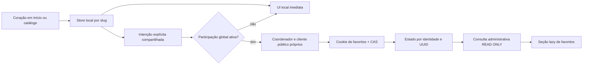

# Dashboard V2 — Fase 2.1: arquitetura dos favoritos globais

**Proposta para aprovação; nenhuma funcionalidade implementada.** Revisão de 28/10/2026, America/Sao_Paulo, sobre HEAD `c775697`. As alterações locais em `AdminRegioes.css`, `AdminRegioes.jsx` e `MetricasDashboard.test.jsx` foram preservadas. Esta entrega acrescenta somente este documento em `backend/docs/`, caminho já permitido pelo `.gitignore`.

Recomendação: manter o coração e a lista local independentes; oferecer participação própria para sincronizar **estado ativo por credencial e patrimônio**, com revisão monotônica, compare-and-swap (CAS), tombstones e transações curtas. Calcular o estoque por consulta, sem contador materializado ou histórico de cliques inicialmente. Credencial, preferência, flags, serviços e consulta administrativa serão próprios de favoritos. Nenhum vínculo com a identidade diária das visualizações.

O responsável informa que a Fase 1 foi aprovada no GitHub Actions. Essa informação atualiza o contexto dos relatórios antigos que ainda registram CI remoto pendente; esta investigação não consultou uma execução remota nem certifica implantação pública. Flags versionadas continuam desligadas. Não houve acesso a banco, execução de migrations, testes, lint, build, Docker, atualização de dependências, commit, push ou deploy nesta etapa documental.

## 1. Diagnóstico do código atual

### Favoritos locais e consumidores

| Caminho real | Comportamento conferido |
| --- | --- |
| [favoritosStore.js](../../frontend/src/features/favoritos/favoritosStore.js) | Chave `portal-guarulhos:favoritos:v1`; array JSON de identificadores públicos `item.id`, que são **slugs**, não UUIDs SQL. Remove duplicatas/entradas inválidas, aceita strings de até 200 caracteres, limita a 500 e descarta o mais antigo quando uma adição excede o limite. Não armazena o patrimônio completo. |
| [useFavoritos.js](../../frontend/src/features/favoritos/useFavoritos.js) | `useSyncExternalStore` sobre a store, lista convertida em Set, `ehFavorito` e `alternar`. Sem Provider, login ou rede. |
| [FavoritoButton.jsx](../../frontend/src/components/FavoritoButton/FavoritoButton.jsx) | Alterna pelo slug, `aria-pressed`, rótulo adicionar/remover e coração preenchido. Interrompe propagação do clique para não abrir o card. |
| [Inicio.jsx](../../frontend/src/pages/Inicio/Inicio.jsx) | Usa FavoritoButton nos destaques. |
| [PlaquetaCard.jsx](../../frontend/src/features/mapa/PlaquetaCard.jsx) | Usa o mesmo botão; o caminho da pasta não significa que todos os marcadores do mapa tenham favorito. |
| [Patrimonios.jsx](../../frontend/src/pages/Patrimonios/Patrimonios.jsx) | Renderiza PlaquetaCard, lê a store, filtra `?favoritos=1` e conta somente itens presentes no catálogo carregado; ajusta paginação após remoção. |

A ficha `PatrimonioDetalhe.jsx` é o ponto de visualização qualificada da Fase 1; não é o ponto único de favoritos. Instrumentar somente a ficha perderia os cliques de Início e catálogo. Não foi encontrado um serviço remoto de favoritos ou modelo Prisma correspondente.

Falhas ao obter/gravar localStorage são toleradas. Enquanto `gravacaoPendente` está ativa, a memória prevalece sobre storage antigo; a store tenta persistir depois. Sem armazenamento utilizável, favoritos duram apenas na página. O evento `storage` atualiza outras abas, inclusive `key=null`; não oferece operação atômica entre duas abas. Duas escritas simultâneas podem substituir listas locais. Essa limitação existente não será apresentada como resolvida pelo CAS do servidor.

Inicialização, recuperação de storage e notificação de lista não carregam uma distinção de intenção de usuário. **Observar somente o array final seria insuficiente**: carregamento, catálogo parcial ou sincronização entre abas poderiam ser interpretados como adições/remoções. A Fase 2.3 deverá acrescentar um canal de intenções na camada comum, preservando o contrato local e seu formato. Descarte pelo limite de 500 deve produzir intenção de remoção do vínculo global previamente conhecido; `localStorage.clear()` não autoriza apagar todos os vínculos globais.

### Participação e credencial da Fase 1

| Caminho real | Estado atual e consequência |
| --- | --- |
| [participacaoStore.js](../../frontend/src/features/metricas/participacaoStore.js) | Preferência `portal-guarulhos:metricas:participacao:v1`, escolhas aceita/recusada, geração UUID local; GPC prevalece e storage bloqueado leva a memória. Eventos storage/focus/pageshow/visibilidade releem preferência. Não reutilizar essa escolha para favoritos. |
| [ParticipacaoMetricas.jsx](../../frontend/src/features/metricas/ParticipacaoMetricas.jsx), montado por [Footer.jsx](../../frontend/src/components/Footer/Footer.jsx) | Painel opcional recolhível. Aceite não emite cookie imediatamente; o detalhe confirmado inicia o fluxo após qualificação. A revogação não elimina agregados de visualização. |
| [coletaMetricas.js](../../frontend/src/features/metricas/coletaMetricas.js) | Fila por aba, Web Locks quando permitido, prazo compartilhado sem segredo, retry limitado de eventos, sem fila offline. Fallback de SecurityError antes do callback, corrigido na 1.4C. A retirada interrompe envio e tenta DELETE; falha não reativa participação. |
| [metricasPublicasApi.js](../../frontend/src/services/metricasPublicasApi.js) | Fetch relativo, sem JWT, prefixo fixo `/api/metricas/visualizacoes`, timeout 3 s, cancelamento e erros próprios. Não é cliente genérico pronto para favoritos. |
| [cookieMetricasService.js](../src/services/cookieMetricasService.js) | Cookie diário assinado, nonce aleatório de 32 bytes, chave por dia e finalidade, HMAC específico por patrimônio. Expira no fim do dia paulista. Revogação apenas limpa cookie; não há cadastro central dessa credencial. |
| [config/metricas.js](../src/config/metricas.js) | Flags de coleta/consulta separadas; coleta desligada não interpreta segredos. Habilitada exige origem, modo HTTPS ou http-local restrito e chaves versionadas. |
| [metricasRoute.js](../src/routes/metricasRoute.js) | Montado em TODO `/api/metricas`, aplica flag, origem, Host/transporte, cookie diário e JSON; aceita somente rotas de visualizações e termina com 404. DELETE atual é exceção própria. Um subrouter de favoritos simplesmente montado depois seria bloqueado. |

### Dashboard, persistência e operação

| Caminho real | Estado atual |
| --- | --- |
| [AdminDashboard.jsx](../../frontend/src/features/admin/pages/AdminDashboard.jsx), [GraficosDashboard.jsx](../../frontend/src/features/admin/components/GraficosDashboard.jsx) | V1 administrativa em todos os status, quatro gráficos, Recharts lazy e componentes Card/Chart com CSS Modules. Preservar. |
| [SecaoMetricas.jsx](../../frontend/src/features/admin/components/SecaoMetricas.jsx), [MetricasDashboard.jsx](../../frontend/src/features/admin/components/MetricasDashboard.jsx) | Seção recolhida sob demanda, lazy e erro independente; ranking paginado, série diária, regiões, sem região e cobertura de visualizações. |
| [dashboardApi.js](../../frontend/src/services/dashboardApi.js), [metricasDashboard.js](../../frontend/src/features/admin/metricasDashboard.js) | Axios administrativo; envelope `{success,data}`; valida período inclusivo até 366 dias, unidade diária, BigInt e somas. Esse validador não serve para estoque atual de favoritos. |
| [dashboardRoute.js](../src/routes/dashboardRoute.js), [dashboardMetricasService.js](../src/services/dashboardMetricasService.js) | `/api/admin/dashboard` e `/metricas`: authenticate + ADMIN/EDITOR. Consulta V2 em RepeatableRead READ ONLY, `favoritos:{disponivel:false}`, campos de cobertura efetivos da 1.4A. A flag de consulta de visualizações controla a resposta inteira. |
| [schema.prisma](../prisma/schema.prisma), [prisma.config.js](../prisma.config.js) | PostgreSQL, Prisma 7.10.1 e adapter-pg; modelos VisualizacaoUnicaDia, VisualizacaoTotalDia, SondaMetricas, OperacaoMetricas e DiaMetricasConferido, além do acervo/auth. Não há FavoritoGlobal. Há 11 migrations na linhagem principal; não usar `prisma/lineages/equipe` como trilha de implantação. |
| [identidadeEditorial.js](../src/utils/identidadeEditorial.js) | `legadoEditorial` e `destinoPublicoWhere` excluem legados por UUID **ou** slug. Região vem de `Patrimonio.regiaoId`. |
| [adminPatrimonioRoute.js](../src/routes/adminPatrimonioRoute.js) | Há arquivamento; não há DELETE físico de patrimônio. DELETE de imagens/documentos não equivale à exclusão do bem. |
| [10-roles.sh](../../infra/postgres/10-roles.sh), [permissoes_metricas.sql](../scripts/sql/permissoes_metricas.sql) | Migrator tem DDL; API não. Default privileges concedem CRUD nas tabelas novas, depois restringido explicitamente nas métricas. Operador possui grants específicos de manutenção; não herda acesso automaticamente a novos modelos. |
| [operacaoMetricasService.js](../src/services/operacaoMetricasService.js), [reter_metricas.js](../scripts/reter_metricas.js), [observar_metricas.js](../scripts/observar_metricas.js) | Retenção/sondagem de visualizações já implementadas. Não inferir delas cobertura de sincronização de favoritos. |
| [predeploy.yml](../../.github/workflows/predeploy.yml), [validar_metricas_test.js](../scripts/validar_metricas_test.js) | PostgreSQL descartável novo, identificação, bootstrap, deploy/repetição, checksums, grants, suíte e integridade; Node 24, lint/build/audits e ensaio Nginx. Futuras migrations precisam entrar nas expectativas e testes, não editar as onze anteriores. |

Fontes históricas consultadas: [arquitetura consolidada](dashboard_v2_1_arquitetura_metricas.md), [1.1](../reports/dashboard_v2_fase_1_1.md), [1.2](../reports/dashboard_v2_fase_1_2.md), [1.3](../reports/dashboard_v2_fase_1_3.md), [1.4A](../reports/dashboard_v2_fase_1_4a.md), [1.4B](../reports/dashboard_v2_fase_1_4b.md), [1.4C](../reports/dashboard_v2_fase_1_4c.md) e [operação](operacao_metricas.md). O código atual prevalece sobre pendências já resolvidas dos relatórios. Exemplos: quota antiga de dez sessões/hora já substituída; cobertura já instrumentável; trilha de onze migrations já homologada no descartável. As duas divergências preexistentes de ON UPDATE das FKs de autenticação continuam fora deste escopo.

## 2. Arquitetura recomendada e alternativas

| Alternativa | Vantagem | Limitação | Decisão proposta |
| --- | --- | --- | --- |
| Incrementar/decrementar contador a cada clique | Implementação inicial curta | Retry, corrida e perda de resposta corrompem o estoque | Rejeitar |
| Estado booleano por par, último pedido recebido vence | Unicidade impede duplicação do par | Adição atrasada pode desfazer remoção posterior | Insuficiente isoladamente |
| Estado por par + revisão monotônica + CAS + tombstone | Repetição não duplica e pedido antigo não sobrescreve revisão nova | Exige tratamento de conflito no cliente; tombstones ocupam espaço | **Recomendado** |
| Log imutável de todos os comandos | Histórico detalhado/reprocessamento | Mais retenção, dados comportamentais e complexidade | Fora desta fase |
| Contadores materializados/cache global | Leitura potencialmente mais rápida | Expiração/revogação/arquivamento exigem invalidação e reconciliação | Somente após EXPLAIN/carga demonstrarem necessidade |

Dois modelos de domínio bastam inicialmente: identidade pseudônima com expiração e vínculo com estado/revisão. A identidade não é User/AuthSession, não tem e-mail e não representa pessoa. Cada par identidade/patrimônio contribui no máximo uma unidade ativa. A mesma pessoa em dois dispositivos ou após perder cookie pode contribuir duas vezes; não há deduplicação pessoal.



Não criar fila externa, Redis, SDK de analytics, fingerprint ou contador no cadastro patrimonial. Usar Express 5, Prisma 7, PostgreSQL 17, React 19 e Recharts instalados. Reaproveitar padrões de proteção e componentes, mantendo finalidades e estados separados.

## 3. Participação, importação e revogação

### Escolha específica

Novo painel proposto “Participação em favoritos globais”, próximo ao painel existente do rodapé, sem modal obrigatório. O coração continua local antes/depois da escolha, sem login. Consentimento de visualizações não autoriza favoritos; revogar uma finalidade não revoga a outra.

Preferência proposta `portal-guarulhos:favoritos-globais:participacao:v1`: versão de formato, versão do texto, escolha e geração local. Não guardar nonce, assinatura, cookie ou JWT. Estados de interface: não escolhido, recusado, aceito, sincronização pendente, conflito, indisponível e revogação pendente. Persistência negada mantém escolha em memória; recarga não presume nova adesão.

Aceitar participação autoriza somente **intenções futuras**, não todos os itens já armazenados. Oferecer ação distinta, desmarcada por padrão: “Incluir meus favoritos locais atuais”. Exibir a quantidade resolvida e os itens que permanecerão apenas locais; confirmar antes de enviar. Um aceite de importação não vira permissão permanente de reimportar listas a cada montagem. Não registrar datas antigas inventadas.

Resolver slug → UUID com a API pública real (`GET /api/patrimonios/:slug`) ou catálogo confirmado que já contenha UUID, em concorrência limitada e sem usar mocks. A validação final PUBLICADO/canônico é sempre do backend. Slug legado redirecionado/resolvido para outra identidade exige mostrar a equivalência antes da importação; não renomear o favorito local ou transferir vínculo silenciosamente. Itens ausentes/privados ficam locais.

### GPC, cookies e identidade perdida

GPC ativo impede iniciar, renovar ou enviar adições. Ao surgir durante participação existente, interromper fila e tentar revogar a participação global; só anunciar eliminação após confirmação do servidor. Se GPC desaparecer, exigir nova escolha global explícita: **não restaurar automaticamente o aceite salvo**. É uma proposta conservadora específica desta finalidade; não altera a política já implementada nas visualizações. Remoções e revogação continuam permitidas sob GPC; a API pode considerar `Sec-GPC: 1` para rejeitar adesão/adição, sem tratar ausência desse header como consentimento.

Cookie bloqueado: GET próprio após bootstrap deve confirmar a identidade antes do primeiro PUT. 401 interrompe sincronização, não inicia loop de emissão. LocalStorage/Web Locks bloqueados: coração funciona em memória; coordenador também, com garantias entre abas reduzidas. Manter a proteção contra SecurityError da 1.4C. Nenhum fallback por IP.

Perder cookie torna os vínculos anteriores inacessíveis ao visitante. Não recuperá-los por IP, nomes, lista local ou suposta pessoa. Permanecem até expirar; uma adesão nova requer ação explícita e uma nova importação opcional. Mudança de navegador/dispositivo tem a mesma limitação. Cookie é segredo portador: uma cópia roubada permite operar aquela identidade até revogação/expiração.

### Revogação confirmada versus intenção local

1. Registrar recusa local, cancelar trabalhos pendentes e impedir novos PUTs imediatamente.
2. Enviar DELETE próprio, com a geração da identidade esperada; servidor bloqueia a identidade, exclui seus vínculos e a identidade na mesma transação.
3. Só depois do commit retornar 204 e expirar cookie. Preservar integralmente favoritos locais.
4. Em 503/rede, mostrar “Envios interrompidos; remoção no servidor pendente”. Não apagar deliberadamente a última credencial utilizável antes da confirmação. Repetir apenas a retirada, de forma limitada, ou por ação explícita; nunca reenviar adições enquanto pendente.
5. Cookie já ausente/inválido: 204 pode encerrar a sessão do navegador, mas não prova remoção de identidade anterior desconhecida. Informar essa limitação; não dizer “todos os dados anteriores apagados”.

Desligar ingestão não pode desligar a capacidade de retirada. Com tabelas já implantadas, manter configuração mínima de validação/revogação mesmo com flags de ingresso/consulta falsas. Sem chave necessária ou sem banco, responder 503, sem alegar exclusão bem-sucedida. Antes de implantação da Fase 2, a aplicação deve continuar iniciando normalmente com todas as flags falsas, sem tabelas/segredos novos e sem consultas de favoritos no startup.

## 4. Credencial, expiração e separação criptográfica

Proposta de cookie HTTPS: `__Host-portal_favoritos`, HttpOnly, Secure, SameSite=Lax, Path=/, sem Domain. Desenvolvimento: `portal_favoritos_local`, somente http-local loopback fora de produção. Nome, raiz criptográfica, key IDs e nonce independentes de JWT e `__Host-portal_metricas`. O prefixo Host exige Secure, Path=/ e ausência de Domain; HttpOnly não impede envio de requisições por JavaScript da própria origem. [Referência de cookies](https://developer.mozilla.org/en-US/docs/Web/HTTP/Reference/Headers/Set-Cookie).

Formato conceitual `v1.kid.nonce.assinatura`, nonce gerado com 32 bytes criptograficamente aleatórios. Derivar chaves HMAC-SHA-256 de uma raiz **exclusiva de favoritos**, com campos codificados inequivocamente (array JSON), rótulos `portal-favoritos`, versão 1, kid e finalidade `cookie` ou `lookup`. Assinar versão/kid/nonce; comparar assinatura em tempo constante. Persistir apenas `HMAC(Klookup, nonce)` e kid, nunca token cru. A assinatura não dispensa consulta à identidade, expiração e existência no banco. Não incluir data diária nem patrimônio na chave da identidade de favoritos.

Hipótese recomendada para aprovação: expiração inicial em **180 × 24 horas UTC** após adesão, sem extensão em GET, PUT, navegação ou reutilização de sessão. Renovação por ação explícita “Continuar participação”, com expiração esperada em CAS; máximo 180 dias adicionais a partir desse ato. Guardar somente última adesão/renovação e versão do texto. Não transformar atividade passiva em retenção indefinida. O prazo difere do dia paulista das visualizações.

Rotação: configuração própria com kid ativo para emissões e chaves antigas em validação, com prazo de retirada conhecido. Renovação não pode ultrapassar a data final de aceitação da chave. Ao atingir esse limite, exigir nova adesão e decisão sobre importar o estado local; não renovar silenciosamente credenciais antigas para sempre. Uma rotação futura que preserve vínculos com troca do token exigirá protocolo próprio de confirmação/replay; **não implementá-la implicitamente na primeira entrega**. Comprometimento de chave exige bloquear ingressos, excluir/inutilizar identidades daquele kid e solicitar nova adesão. Não reutilizar segredos/datas da Fase 1 para simplificar.

HTTP não consegue provar que o usuário leu o texto; `versaoPolitica` registra a escolha protocolar, não certificação jurídica. Todas as instâncias precisam de keyring e relógio coerentes. Não devolver token em JSON, logs ou metadados de gráfico. `participacaoId` exposto ao próprio cliente é UUID não secreto para detectar troca de identidade; nunca autentica sem cookie e nunca vai ao dashboard.

## 5. Modelos Prisma propostos

Blocos para revisão; **não inseridos no schema, não validados pelo CLI, não constituem migration**. Manter generator/datasource e Prisma 7 atuais.

```prisma
model IdentidadeFavoritos {
  id                String           @id @default(dbgenerated("gen_random_uuid()")) @db.Uuid
  chaveId           String           @map("chave_id") @db.VarChar(20)
  tokenHash         String           @map("token_hash") @db.Char(64)
  versaoPolitica    Int              @map("versao_politica")
  criadoEm          DateTime         @default(now()) @map("criado_em") @db.Timestamptz(3)
  ultimaAdesaoEm    DateTime         @map("ultima_adesao_em") @db.Timestamptz(3)
  expiraEm          DateTime         @map("expira_em") @db.Timestamptz(3)
  favoritos         FavoritoGlobal[]

  @@unique([chaveId, tokenHash])
  @@index([expiraEm, id])
  @@map("identidades_favoritos")
}

model FavoritoGlobal {
  identidadeId   String               @map("identidade_id") @db.Uuid
  patrimonioId   String               @map("patrimonio_id") @db.Uuid
  ativo          Boolean              @default(false)
  revisao        BigInt               @default(1)
  comandoId      String               @map("comando_id") @db.Uuid
  atualizadoEm   DateTime             @map("atualizado_em") @db.Timestamptz(3)
  identidade     IdentidadeFavoritos  @relation(fields: [identidadeId], references: [id], onDelete: Cascade, onUpdate: Cascade)
  patrimonio     Patrimonio          @relation(fields: [patrimonioId], references: [id], onDelete: Restrict, onUpdate: Cascade)

  @@id([identidadeId, patrimonioId])
  @@index([patrimonioId, ativo, identidadeId])
  @@map("favoritos_globais")
}
```

Relação inversa futura em Patrimonio: `favoritosGlobais FavoritoGlobal[]`. Nome IdentidadeFavoritos evita chamar o registro de navegador físico. `comandoId` guarda somente o último comando aceito por par para reconhecer resposta perdida; não é histórico de navegação ou ID global de pessoa.

Constraints SQL futuras: revisão > 0 e incremento sem overflow de bigint; hash hexadecimal de 64 caracteres; versão de política positiva; `criadoEm <= ultimaAdesaoEm < expiraEm`; intervalo desde última adesão até expiração no máximo 180 dias. SQL parametrizado deve atualizar timestamp explicitamente. PK garante uma linha por par. Ausência representa `ativo=false,revisao="0"`; primeira remoção válida cria tombstone em revisão 1 para bloquear uma adição antiga com revisão 0.

Tetos propostos por identidade, conferidos dentro do lock: 500 vínculos ativos (incluindo arquivados) e 2.000 pares totais, contando tombstones. Remover um vínculo existente e revogar continuam possíveis no teto. Não eliminar tombstones antecipadamente para abrir espaço: isso permitiria replay antigo. Esgotamento exige mensagem e decisão explícita de encerrar/reiniciar participação, sem apagar favoritos locais. Esses tetos são parâmetros a aprovar, não quantidades reais do acervo.

O índice de expiração atende purga; PK atende estado próprio; índice por patrimônio/ativo atende ranking. Não adicionar índice por timestamp, IP, UUID de usuário ou região duplicada. Região será join à FK atual. Avaliar índice parcial `WHERE ativo` somente com EXPLAIN; não propor índice parcial dependente de `now()`. Sem particionamento, tabela de eventos ou contador redundante inicial.

## 6. Invariantes, transações e comandos fora de ordem

1. Contribuição máxima de um ativo por identidade/patrimônio; add/add/remove/remove/add termina em um ativo, nunca cinco cliques.
2. Identidade expirada ou excluída não contribui, mesmo se limpeza física estiver atrasada.
3. Comando só muda estado se a revisão esperada corresponde à corrente; não aceitar timestamp do cliente como ordenação.
4. Tombstone preserva revisão até expiração/revogação; nunca DELETE do par ao desfavoritar.
5. Nenhuma resposta de sucesso precede commit; rollback não deixa atualização parcial.
6. Total, ranking e regiões usam a mesma população filtrada, mesmo snapshot e mesmo instante de expiração. Não somar a página como total.
7. Nunca juntar diretamente favoritos × visualizações × categorias secundárias: esse produto multiplica contagens.

**Ordem proposta de locks para PUT:** validar forma/origem/cookie; abrir transação curta ReadCommitted; obter identidade `FOR UPDATE` e revalidar expiração/participacaoId; obter patrimônio `FOR SHARE` para conferência de elegibilidade; ler/alterar vínculo com CAS; commit. Serializar por identidade também protege tetos e renovação/revogação, sem bloquear todas as identidades do patrimônio. Revalidar o relógio após esperar pelo lock; expiração na admissão dentro da transação define aceitação. Um commit após expirar não torna o vínculo visível ao ranking, que aplica seu próprio instante.

Remoções de vínculos existentes permitem bens hoje não públicos; não exigir que sejam republicados para desfavoritar. Ausência + false só cria tombstone para UUID público canônico existente, sem revelar bens privados desconhecidos. Mudanças editoriais são serializadas pelo FOR SHARE; futuras operações de manutenção do acervo devem respeitar ordem de locks, sem alterar o serviço editorial nesta fase. Revogação/purga bloqueiam identidade e excluem filhos, sem bloquear patrimônio. Não reusar advisory locks numéricos de retenção de visualizações para outro recurso. [Semântica de locks PostgreSQL 17](https://www.postgresql.org/docs/17/explicit-locking.html).

Limites iniciais herdados como hipótese a testar: lock_timeout 200 ms, statement_timeout 750 ms para mutação simples, maxWait 500 ms e transação 2 s; remoção de até 2.000 vínculos precisa benchmark antes de fixar o mesmo orçamento. Falha de lock/serialização/deadlock → 503 com Retry-After, rollback, sem retry oculto de escrita no servidor. Nenhum acesso HTTP externo dentro da transação. Usar `$transaction` e APIs do Prisma **7 instalado**, não exemplos de versões futuras.

CAS e idempotência:

| Pedido | Resultado |
| --- | --- |
| Revisão esperada igual à atual, comando novo | Aplicar booleano desejado e incrementar revisão, mesmo se o booleano for igual; atualizar comandoId |
| Mesmo comandoId, mesmo booleano e revisão atual = esperada + 1 | Replay imediato: devolver estado atual 200 sem incrementar revisão ou renovar prazo |
| Mesmo comandoId com outro conteúdo | 409; nunca reutilizar UUID de comando para uma intenção nova |
| Revisão antiga após outro comando | 409 com estado/revisão atuais; não desfazer o comando mais novo |
| Duas adições simultâneas em revisão 0 | Uma aceita; outra replay ou 409; uma linha/um ativo |
| Remoção aceita antes de adição antiga | Tombstone/revisão impedem ressuscitar o favorito |
| Resposta perdida e depois estado alterado em outra aba | GET/409 informa estado atual; não é possível provar o resultado histórico só com o último comando armazenado |

Cliente pode reenviar **o mesmo payload**, na mesma identidade e com limite de tentativas; nunca aumentar automaticamente revisãoEsperada de uma intenção antiga para fazê-la passar. Se conflito já apresenta o estado desejado, sinalizar convergência sem afirmar autoria do comando. Se divergente, manter coração local e oferecer “Usar minha escolha atual no global” como novo comando explícito. Uma intenção posterior criada antes de conhecer o resultado da anterior precisa ser ordenada na fila; não tratar entrega de rede como ordem de cliques.

## 7. Coordenação no frontend e múltiplas abas

Propor `favoritosGlobaisStore.js` como coordenador único por aplicação; `favoritosStore.js` continua dono do estado local. Canal de intenções futuro inclui slug, estado desejado, causa (clique/descarte/importação aprovada) e geração. Mount, refetch, evento storage e catálogo incompleto não são cliques. Botões não abrem sessões nem fazem requisições individualmente.

Metadados em chave lateral versionada: participacaoId não secreto, prazo, revisão por UUID e no máximo 500 intenções pendentes, até sete dias, só a mais recente ainda não enviada por bem. Requisição já enviada mantém seu payload para reconciliação. Nunca portar fila para identidade nova; expiração/perda de cookie limpa metadados de sincronização, preservando lista local. Como favoritos são estado, pode haver fila offline; isso é diferente das visualizações, que não podem reenviar eventos no dia seguinte.

Web Locks coordena bootstrap e envios entre abas quando disponível; BroadcastChannel/storage avisam alterações sem criar intenções duplicadas. Lock é otimização, não garantia de segurança. Cada mutação envia `X-Portal-Participacao` com o UUID esperado; o servidor o confronta com a identidade autenticada pelo cookie. Uma resposta tardia de bootstrap pode sobrescrever cookie: o UUID esperado impede que comandos destinados à identidade anterior sejam aplicados à nova inadvertidamente.

Antes do primeiro PUT, confirmar sessão pelo GET próprio. Bootstrap reutiliza cookie válido e não tem retry automático após resposta perdida. Sem lock/cookie compartilhado, duas emissões iniciais ainda podem criar identidades distintas. Não prometer deduplicação perfeita por navegador: cada identidade tem sua unicidade, e emissões extras sem vínculos não são audiência. Uma identidade anterior já ativa cujo cookie se perdeu pode continuar contribuindo até expirar. Expor esse limite na revisão de produto.

Não substituir favoritos locais pelo GET remoto. GET serve para revisões/conflitos e feedback; importar estado remoto para a lista local seria outra funcionalidade. Preferência global e ações antigas não se tornam “aceitas” por existir cookie. Usuário administrativo conhecido continua podendo usar coração local; propor excluir sincronização global dessa navegação, sem pretender reconhecer equipe anônima. Falha de métricas nunca chama logout/refresh administrativo.

## 8. Elegibilidade e significado do ranking

Recomendação: ranking padrão contém **vínculos ativos de identidades vigentes em patrimônios canônicos atualmente PUBLICADO**. Não é histórico de popularidade. Pode diminuir por remoção, expiração, revogação ou arquivamento.

| Evento | Vínculo / apresentação |
| --- | --- |
| Publicação de bem novo | Não cria favoritos; passa a ser elegível a novas adições |
| Arquivamento/retorno a rascunho | Mantém booleano/revisão; sai do ranking publicado. Admin pode consultar recorte separado de não publicados |
| Republicação | Vínculo ainda ativo e identidade vigente volta ao ranking; não inventa novo clique nem renova expiração |
| Mudança de região | Redistribui estoque pela FK atual; não é região do visitante |
| Região inativa | Aparece identificada se houver vínculos; nulos continuam em “Sem região” separado |
| Legado PUBLICADO por inconsistência | Rejeitar adição; excluir de rankings canônicos por UUID e slug. Vínculo excepcional existente não é transferido para canônico; permitir remoção/revogação |
| Desfavoritar bem hoje privado/legado | Remoção própria permitida; retorno apenas UUID/estado/revisão, sem revelar nome, descrição ou slug privado |
| Exclusão física futura | Não existe endpoint atual. FK RESTRICT bloqueia manutenção acidental; eventual procedimento separado deve eliminar vínculos explicitamente, com revisão, sem cascata editorial silenciosa |

“Preservar vínculo” não significa guardar histórico de ações. Um false mantém somente o último estado para defesa contra replay. Não haverá série diária de favoritos, `favoritos_7d`, taxa de conversão por visitante ou score Gemini nesta etapa.

## 9. Contratos HTTP propostos

**Rotas novas, ainda inexistentes.** Cliente público proposto `frontend/src/services/favoritosPublicosApi.js`, independente de `services/api.js` e do cliente de visualizações. Fetch relativo, credentials same-origin, no-store, sem Authorization, sem redirects/refresh/logout. JSON estrito nos corpos, máximo 2 KB, UUIDs validados e strings decimais para revisões.

Todas as respostas JSON usam `{success:true,data:...}`; erros seguem o envelope padrão `{success:false,error:{code,message}}`, podendo acrescentar `error.estadoAtual` próprio em conflito. Nunca retornar contadores globais em rota pública.

| Método / caminho | Entrada | Sucesso e idempotência |
| --- | --- | --- |
| POST `/api/metricas/favoritos/sessao` | `{versaoPolitica:1}`; escolha explícita | 200 `{participacaoId,expiraEm,versaoPolitica}` + cookie. Cookie vigente é reutilizado sem prolongar prazo nem criar outra identidade; cookie inválido/expirado → 401, sem criação automática |
| GET `/api/metricas/favoritos/sessao` | Cookie próprio | 200 mesmos metadados; confirma que o navegador devolveu cookie, não renova prazo. Ausência/expiração → 401 |
| POST `/api/metricas/favoritos/sessao/renovar` | `{versaoPolitica:1,expiracaoEsperada:ISO}` + `X-Portal-Participacao` | 200 metadados e cookie atualizado, apenas por escolha explícita. CAS de expiração; replay antigo → 409, nunca nova extensão automática |
| GET `/api/metricas/favoritos` | Cookie; `apos=UUID` opcional e `limite=1..100` (padrão 100) | 200 `{participacaoId,expiraEm,itens:[{patrimonioId,ativo,revisao,comandoId}],proximoCursor}`; ativos e tombstones, somente próprios, ordem UUID. Não consulta identidade de terceiros |
| PUT `/api/metricas/favoritos/:patrimonioId` | `{ativo:boolean,revisaoEsperada:"0",comandoId:UUID}` + `X-Portal-Participacao` | 200 `{participacaoId,patrimonioId,ativo,revisao,comandoId}` após commit; mesmo endpoint para adição e remoção, nunca toggle/incremento |
| DELETE `/api/metricas/favoritos/sessao` | Cookie e `X-Portal-Participacao` quando conhecida; sem corpo | 204 após exclusão atômica e cookie expirado; repetição sem identidade → 204. Cookie que autentica outra identidade que a esperada → 409, sem apagá-la |
| GET `/api/admin/dashboard/favoritos` | JWT ADMIN/EDITOR; filtros abaixo | 200 `{success:true,data:{disponivel,...}}`; somente agregados; flag de consulta falsa → `{disponivel:false,motivo:"DESATIVADA"}` |

Ausência de cookie no POST de adesão pode criar identidade; após 401 com cookie expirado, orientar encerramento da sessão antiga e nova escolha antes de criar outra. Não usar chamada automática de renovar/criar como tratamento genérico de 401. GET paginado próprio não promete snapshot entre páginas; cada PUT usa CAS, e o cliente não deduz remoções de itens ausentes em uma leitura concorrente.

Erros comuns: 400 schema/query/campo extra; 401 participação ausente/expirada (público) ou JWT inválido (admin); 403 origem/Host/transporte/perfil ou GPC em adesão/adição; 404 uniforme para alvo inelegível/desconhecido sem vínculo próprio; 409 revisão/geração/renovação em conflito ou limite de pares/ativos, com código específico; 413 corpo; 415 formato; 429 com Retry-After; 503 infraestrutura/configuração/ingresso desligado. Não usar 204 como confirmação se a persistência falhou.

### Origem, roteamento e flags

Mutações exigem Origin exata, Host esperado, transporte coerente, `X-Portal-Metricas: 1` e Fetch Metadata compatível. JSON evita formulários simples; SameSite não substitui validação de origem. GET same-origin de fetch pode não enviar Origin: exigir Host/transporte, header próprio, cookie e `Sec-Fetch-Site: same-origin` quando Origin estiver ausente; se ambos os sinais faltarem, recusar pelo contrato conservador e homologar navegadores suportados. Não exigir um header Origin que o JavaScript não consegue definir. GET não tem Content-Type obrigatório nem produz efeitos. Todos os caminhos no-store.

Na 2.2, montar subrouter `/api/metricas/favoritos` **antes** do atual `/api/metricas` em `app.js`, com proteções/parser/404 próprios, para não cair na flag, cookie diário, JSON obrigatório em GET ou 404 final de visualizações. Preservar as rotas antigas e cobrir colisões/caminhos desconhecidos em testes. Alternativa é separar um roteador raiz, mas a montagem delimitada produz menor diff inicial. Não relaxar globalmente o middleware da Fase 1 para acomodar favoritos.

Flags propostas, todas false: `FAVORITOS_GLOBAIS_INGESTAO_ATIVA`, `FAVORITOS_GLOBAIS_CONSULTA_ATIVA`, `VITE_FAVORITOS_GLOBAIS_ATIVOS`. Configuração própria de origem/mode/keyring. Habilitar ingresso exige configuração válida e trilha operacional aprovada; consulta pode funcionar com ingresso false. DELETE e leitura própria para administrar a participação devem continuar disponíveis quando ingresso false, com credencial e configuração de gestão existentes. V1 e Fase 1 devem subir sem segredos de favoritos. Não confiar em flag do frontend para segurança.

O proxy Vite atual já cobre `/api/metricas/favoritos`; o limite Nginx de 2 KB também. Não enviar importação de 500 itens em um corpo único: resolver e enviar por item com fila limitada. Preservar uploads 12 MB, CORS, JWT e trust proxy. `infra/nginx.conf` é montado pelo Compose; `frontend/nginx.conf` vale sem montagem. HTTPS definitivo/peers ainda dependem da infraestrutura, como registrado na 1.4C; não assumir nova definição nesta análise.

### Quotas e abuso

Propor limitador próprio por finalidade, usando rede somente transitoriamente para proteção: novas identidades 120/h e 60/min por IPv4 ou IPv6 /64 como ponto inicial a calibrar; reutilização validada não consome emissão; 30 PUTs/min por identidade e 60 leituras/min; teto agregado de rede preserva defesa contra rajadas. A borda existente continua limite comum às duas finalidades. Não duplicar inadvertidamente um orçamento de abuso sem medir o efeito total.

NATs de escolas/bibliotecas não são uma pessoa. Importação explícita de 500 itens pode levar mais de 16 minutos a 30/min: mostrar progresso/cancelamento, respeitar Retry-After e permitir retomada sem nova autorização de itens já aprovados dentro da mesma participação. Aprovar eventual quota de importação diferente somente após carga/abuso, não ampliar limites silenciosamente. Retirada tem orçamento reservado, não disputa a quota de adições; a borda ainda protege contra rajadas. Limites locais em Map não são distribuídos, e múltiplas réplicas exigem armazenamento compartilhado ou limitação externa aprovada.

## 10. Consulta administrativa e integração visual

Recomenda-se **endpoint independente** `/api/admin/dashboard/favoritos`. O caminho antigo `/metricas` continuará retornando seu contrato, inclusive placeholder `favoritos:{disponivel:false}`, até uma revisão explícita de descontinuação desse placeholder. O texto futuro do painel de visualizações deve remeter à seção própria, sem anunciar que todo o recurso de favoritos está indisponível.

Esta escolha diverge da proposta antiga de preencher `favoritos` no DTO de visualizações: o contrato real exige datas e fica indisponível quando a flag de visualizações está false. O novo endpoint evita ligar estoque atual a período ou habilitação de outra finalidade, preservando consumidores existentes. Não enviar `inicio`, `fim` ou granularidade ao endpoint de estoque.

Filtros propostos: `escopo=publicados|naoPublicados|todosCanonicos` (padrão publicados), `patrimonioId` opcional, `regiaoId` ou `semRegiao=true` exclusivos, `pagina=1..10000`, `limite=1..100` (UI 10). Região é sempre cadastro atual. Não usar bairro, data da visualização, número editorial ou categorias adicionais para multiplicar vínculos. Legados são excluídos dos três escopos e reportados somente em um diagnóstico agregado separado.

```text
data.disponivel: true
data.meta:
  versaoRegra: 1
  geradoEm: ISO UTC
  unidade: VINCULO_ATIVO_IDENTIDADE_PATRIMONIO
  referenciaTemporal: ESTOQUE_ATUAL
  escopo: publicados
  regiaoReferencia: CADASTRO_ATUAL
  cobertura: PARTICIPACAO_PARCIAL_NAO_MENSURADA
  ingressoAtivo: boolean
data.favoritos:
  totalAtivos: string decimal              # população filtrada, antes da paginação
  porPatrimonio:
    itens: [{id,nome,status,quantidade}]
    paginacao: {pagina,limite,total}         # total de bens, não vínculos
  porRegiao: [{id,nome,ativo,quantidade}]
  semRegiao: string decimal
data.diagnostico:
  vinculosLegadosExcluidos: string decimal # global, explicitamente sem filtros
```

Totais são `count(*)::text` de FavoritoGlobal ativo JOIN identidade vigente JOIN patrimônio elegível. Usar um instante capturado pelo servidor e RepeatableRead READ ONLY, consultas sequenciais, timeout e SQL parametrizado. Ranking agrupa por patrimônio, desempata por UUID, calcula total de bens antes de LIMIT/OFFSET. A soma regional + sem região fecha totalAtivos no mesmo filtro; soma da página pode ser menor. Nenhum identificador de participante, comando, hash, prazo individual ou favorito local vai ao admin.

Frontend futuro: nova seção `SecaoFavoritosGlobais.jsx` e módulo lazy `FavoritosDashboard.jsx`, montados ao lado de SecaoMetricas em AdminDashboard. Reutilizar Card/Chart, Recharts e CSS Modules, sem novos pacotes. Acrescentar `buscarFavoritosDashboard` em dashboardApi usando Axios administrativo. Validar DTO próprio e preservar números exatos com BigInt; acima do limite seguro, tabela textual em vez de arredondar gráfico.

Apresentação: ranking horizontal, total de vínculos ativos no escopo, seletor de publicados/não publicados/todos canônicos e comparativo por região atual. “Sem região” separado. Rótulo “Estoque registrado agora, entre participantes”; não chamar de pessoas, visitantes únicos ou favoritos de todo o público. Tabelas com caption, navegação por teclado/tooltips, status atual, foco visível, desktop/mobile. Totais de V1 não são denominadores.

| Estado | Apresentação |
| --- | --- |
| Flag consulta false | “Favoritos globais ainda não habilitados”, sem zeros simulados |
| API 503/rede/DTO inválido | Erro próprio e tentar novamente; V1 e visualizações continuam |
| Consulta válida com zero | “Nenhum vínculo ativo registrado neste recorte”; não “ninguém favoritou” |
| Ingresso desligado e leitura permitida | Mostrar estoque e horário, avisar que alterações não estão sendo recebidas; remoções/expiração podem continuar reduzindo |
| Participação parcial | Ressalva permanente: favoritos locais, recusas, cookies perdidos e filas offline não são mensurados |
| Estado carregando | Apenas seção nova em loading; cancelamento em desmontagem |

Sondas da Fase 1 certificam condições operacionais de visualizações, não proporção de favoritos sincronizados. Não calcular percentual de cobertura, dividir por cookies emitidos ou pintar estoque como “completo” com base em DISPONIVEL. Começar com ressalva honesta `PARTICIPACAO_PARCIAL_NAO_MENSURADA`; eventual sondagem específica precisa dimensão/contrato próprios e não altera retrospectivamente as sondas existentes.

## 11. Retenção, permissões e operação

| Dado | Proposta de retenção / remoção |
| --- | --- |
| Identidade e vínculos ativos/inativos | Até expiração ou revogação. GET/PUT não renovam. Excluir expirados diariamente, objetivo até 24 h após expiração; consultas os excluem imediatamente |
| Tombstones e último comando | Até fim da mesma identidade; sem histórico de todos os comandos |
| Fila cliente | Até sete dias, no máximo 500 intenções; limpar ao revogar/trocar identidade, nunca a lista local |
| IP/UA/referrer | Não persistir nos modelos; buckets HMAC operacionais de TTL curto, separados da identidade |
| Logs | Só códigos, duração e contagens operacionais; sem cookie/hash/UUID de participante, corpo ou lista de bens por identidade |
| Backups | Prazo próprio a aprovar; não prometer remoção imediata de cópias nem restaurar vínculos revogados silenciosamente |

Rotina futura `backend/scripts/reter_favoritos.js`, separada da retenção de visualizações: advisory lock próprio, seleção ordenada de candidatas expiradas e `DELETE WHERE id = ... AND expira_em <= instante RETURNING id`, em transações pequenas. O DELETE adquire o lock e revalida o predicado diante de uma atualização concorrente em ReadCommitted; a seleção anterior não autoriza excluir uma identidade que foi renovada. Preservar os tetos por identidade. Começar com uma identidade por transação, no máximo 100 por execução; até 2.000 filhos por identidade são limitados pelo serviço. Timeout/rollback e retomada segura; CONCLUIDA/PENDENTE/EM_EXECUCAO/FALHA com mesma convenção operacional, sem alterar checkpoints de visualizações. Nenhuma reconciliação de contadores é necessária inicialmente, pois a consulta deriva do estado.

Renovação, PUT, DELETE e purga coordenam no mesmo lock de identidade: purga só exclui após revalidar expiração; renovação de identidade já expirada não ressuscita vínculos. Alertar último sucesso ausente/atrasado >24 h, acúmulo de expirados, 409/429/503 anormais e divergência de flags/chaves entre réplicas. Não gerar favorito fictício para sondar.

Grants futuros revisados pelo migrator, após migration nova: portal_api SELECT/INSERT/UPDATE/DELETE de identidades para adesão/renovação/revogação e SELECT/INSERT/UPDATE dos vínculos; cascata da identidade remove filhos. Sem DDL, sem permissões adicionais em autenticação. Operador SELECT/DELETE de identidades e SELECT dos vínculos, com remoção dos filhos pela FK CASCADE, sem INSERT/UPDATE de favoritos, sem users. Sua limpeza usa o DELETE condicional, sem SELECT FOR UPDATE que exigiria privilégio UPDATE adicional. SELECT expõe hashes ao papel operacional, razão para restringir credencial ao processo da tarefa. Demonstrar todos os grants/cascatas no descartável. Conferir default privileges do bootstrap e revogar concessões excedentes explicitamente. Não chamar esse controle de RLS: a autorização por participante é implementada no serviço com cookie.

Em restauração, manter ingresso/consulta desligados. Como não se mantém log completo de exclusões, um backup anterior pode ressuscitar vínculos revogados. Recomendação inicial conservadora: invalidar todos os kids de favoritos do backup e eliminar as identidades restauradas antes de reabrir a finalidade, exigindo nova participação e deixando explícita a perda do estoque anterior. Isso exige procedimento autorizado e teste próprio, sem afetar chaves/dados de visualizações. Alternativa com preservação do estoque requer registro separado de supressões fora do backup restaurado e política de retenção própria; não prometer ambas as propriedades sem implementá-lo.

Processos operacionais usam credencial externa e container existente, sem Compose up, seed ou migrations automáticas. Preparar timer próprio ou extensão controlada do agendamento só em fase autorizada; não instalar nesta etapa. Tokens e conexões nunca em arquivos versionados. Minimização reduz exposição, mas **pseudonimização não equivale a anonimato**: a tabela vincula interesses à mesma credencial durante meses.

Atendimento a pedido do participante: oferecer estado próprio legível e revogação com a credencial presente. Sem cookie não há método técnico proposto para localizar seus vínculos sem introduzir nova identificação; o canal institucional deve explicar essa limitação e o prazo. Não pedir e-mail/CPF para “recuperar” a identidade. Base legal, transparência, prazo de 180 dias, tratamento de menores, direitos e backups exigem revisão institucional/jurídica; este documento não afirma conformidade ou aprovação da Prefeitura.

## 12. Plano de implementação e critérios de aprovação

Todos os caminhos abaixo são **previstos**, não arquivos alterados nesta entrega.

| Fase | Arquivos / dependências | Riscos e critérios objetivos |
| --- | --- | --- |
| **2.1 — arquitetura** | Este documento; código atual e relatórios 1.x | Aprovar unidade, elegibilidade, prazo, conflitos, cookies, revogação, quotas e endpoint próprio. Nenhum código/migration/banco alterado |
| **2.2 — backend, banco e segurança** | Novos `src/config/favoritos.js`, `routes/favoritosRoute.js`, `schemas/favoritosSchema.js`, `services/cookieFavoritosService.js`, `favoritosService.js`, `dashboardFavoritosService.js`, `middlewares/limiteFavoritos.js`; adições delimitadas em app.js e dashboardRoute.js; OpenAPI `src/docs/pathsFavoritos.js`; schema e **nova** migration; `scripts/reter_favoritos.js`, `scripts/sql/permissoes_favoritos.sql`; backend/.env.example e guias | Depende de 2.1 aprovada e autorização para testes SQL descartáveis. Deploy limpo/repetido com checksums, CAS/revogação/expiração/locks aprovados, flags falsas sem segredos/tabelas, JWT e rotas antigas intactos. Riscos: grants amplos, deadlock, token órfão |
| **2.3 — frontend e sincronização** | Novos `services/favoritosPublicosApi.js`, `features/favoritos/participacaoFavoritosStore.js`, `favoritosGlobaisStore.js`, `ParticipacaoFavoritos.jsx/.module.css`; canal de intenções em favoritosStore/useFavoritos; Footer; FavoritoButton somente se feedback necessário; frontend/.env.example | Depende de contrato 2.2 validado. Aceite específico, importação explícita, nenhum envio antes da escolha, coração offline/sem cookie intacto, duas abas e conflitos sem sobrescrita silenciosa. Não instrumentar só detalhe. Riscos: storage perdido, comandos atrasados, limite 500 |
| **2.4 — dashboard, integração e homologação** | Novos `features/admin/components/SecaoFavoritosGlobais.jsx`, `FavoritosDashboard.jsx/.module.css` e validador próprio; AdminDashboard e dashboardApi aditivos; ajuste apenas da mensagem antiga de favoritos em MetricasDashboard; testes/fixtures; extensão do trilho `scripts/homologar_metricas.js` ou trilho específico; workflow e guia operacional | V1 quatro gráficos + visualizações três gráficos preservados; estoque exato, BigInt, filtros, paginação, estado desligado/erro independente; E2E real no descartável HTTPS, teclado/mobile e CI. Riscos: interpretar estoque como série, cobertura fictícia, multiplicação de joins |

Testes futuros em `backend/test/` e `frontend/test/`, sem alterar suites existentes para ocultar regressões:

- **Contrato e segurança:** sessão nova/reusada, sem cookie, assinatura falsa, kid antigo/retirado, expiração exata, flags independentes, DELETE com ingresso false, JSON extra/2 KB/chunked, GET sem Origin válido, CSRF, Host/protocolo/XFF forjados, HTTPS Host/HttpOnly/Secure e HTTP local restrito. Anônimo/perfil indevido/conta inativa não leem admin; ADMIN/EDITOR leem só agregados.
- **Concorrência PostgreSQL 17:** 100 PUTs iguais → uma linha/um ativo; replay sem incremento de revisão; false antes de true antigo; CAS conflitante entre abas; resposta perdida; renovação vs purga; revogação vs PUT; arquivamento vs adição; lock timeout curto sem efeitos parciais; rollback após atualização. Expiração não depende do job para deixar de contar.
- **Tetos e ordenação:** 500 ativos, 2.000 pares com tombstones, remoção/revogação ainda disponíveis; comandoId reutilizado com outro conteúdo; overflow de revisão; nunca reabrir revisão zero por limpeza parcial. Quotas de importação e NAT compartilhado medidas, identidade/IP não confundidos.
- **Local e participação:** storage get/set/remove lançando, Web Locks ausente/negado/erro após callback, StrictMode, duas abas, GPC antes/depois do aceite, recusa/revogação, DELETE falho com feedback pendente; localStorage.clear, catálogo parcial e eventos storage não produzem remoções globais inventadas. Favoritos locais preservados inclusive em 401/409/429/503.
- **Importação e fila:** antigos só após confirmação separada; slugs desconhecidos/legados; lote parcial cancelado; múltiplos cliques enquanto requisição em voo; descarte local do mais antigo; fila sete dias; nova identidade não herda comandos da antiga; bootstrap incerto sem loop; cada comando usa UUID confirmado e geração esperada.
- **Agregação:** estoque publicado vs não publicado, republicação, legado excluído, região alterada/inativa/ausente, total antes da paginação, expiração num único instante, BigInt e tabelas exatas. Join de favoritos não multiplica visualizações. Consulta falsa não exige segredos de ingresso.
- **Operação:** deploy em volume novo identificado (host/porta/banco/cluster/papéis/exclusividade) e repetição, checksums históricos intactos, grants sem DDL, expurgo em lotes/crash/retomada/advisory lock, recuperação de backup sem ressuscitar participação revogada, desligamento/reinício, logs sem dados de participante. Não usar `patrimonio_guarulhos` nem Compose normal.
- **Interface/CI:** V1, Fase 1, favoritos locais, navegação e auth completos; desktop/mobile, teclado e leitor de tela; total textual/tooltip, erro/vazio/desativado/parcial. Lint, testes, Prisma, build e audits nas etapas de código; EXPLAIN e p95 do endpoint completo com volume sintético. Meta de referência proposta: leitura até 300 ms p95 no ambiente medido, não garantia prévia. Executar CI remoto apenas após autorização própria para disponibilizar mudanças.

## 13. Matriz de riscos

| Risco | Tratamento proposto | Residual / decisão |
| --- | --- | --- |
| Requisições duplicadas/fora de ordem | PK, CAS, tombstone, último comando e transação | Conflitos divergentes exigem escolha atual; não há ordem global de cliques offline |
| Perda/roubo de cookie e múltiplos dispositivos | Expiração, revogação, segredo independente, identidade esperada | Pode haver contribuições duplicadas entre credenciais; não são pessoas únicas |
| Duas emissões iniciais concorrentes | Lock no cliente, reutilização e GET de confirmação | Sem coordenação não há unicidade por navegador físico |
| Participação acoplada à Fase 1 | Router/config/cookie/cliente/consulta próprios | Pequena montagem aditiva requer regressão de rotas antigas |
| Revogação com backend fora | Interromper local, manter retirada pendente e credencial até confirmação | Exclusão remota não pode ser garantida offline; prazo máximo deve ser informado |
| Restauração de backup antigo | Invalidar/expurgar identidades restauradas antes de reabrir | Perde estoque; preservar estoque requer projeto adicional de supressões |
| Bots e criação em massa | Limites por identidade/rede/borda, tetos e monitoramento | Não prova humanidade; Maps não escalam entre réplicas |
| NAT legítimo/importação grande | Separar reuso/emissão, fila com Retry-After e feedback | Calibrar antes de ativar; importação pode ser demorada |
| Perfil de interesses pseudônimo | Minimização, ausência de log de cliques, prazo finito, admin só agregado | Revisão institucional/jurídica necessária; não chamar anonimato |
| Arquivados/legados distorcem ranking | Escopos explícitos, canonicidade e diagnóstico separado | Republicação pode restaurar contribuição vigente sem novo clique |
| Divergência local/remota | Canal de intenções, CAS e feedback sem reverter coração | Store local ainda não é transacional entre abas; não sincronizar listas cegamente |
| Contagens com JOIN/expiração inconsistentes | Derivar estado num snapshot e instante únicos | Medir desempenho antes de adotar cache/contadores |
| Uso de sondas como cobertura de favoritos | Ressalva própria sem porcentagem inventada | Não se conhece quantos favoritos ficaram apenas locais |

## 14. Decisões pendentes e compatibilidade

Para aprovar a 2.2, decidir:

1. Ranking padrão publicado canônico, preservação dos vínculos arquivados e retorno ao ranking na republicação; disponibilidade dos recortes administrativos separados.
2. Participação específica, importação desmarcada por padrão, GPC com nova escolha após desligamento e eventual exclusão de navegação administrativa conhecida.
3. Prazo de até 180 dias, renovação somente explícita, retirada de chaves e consequência da perda de cookie; textos e revisão institucional/jurídica.
4. PK + CAS + tombstone + último comando; tratamento explícito de conflito sem rebase automático; tetos 500 ativos/2.000 pares e fila sete dias.
5. Endpoint administrativo próprio, sem período; manter contratos V1/visualizações e revisar apenas a mensagem do placeholder antigo.
6. Retirada disponível com ingresso desligado, comunicação de exclusão pendente, papel operacional, alarmes e política de restauração/backup proposta.
7. Quotas sob NAT, tempo de importação, necessidade de limitação compartilhada antes de múltiplas instâncias e definição/homologação de HTTPS final.

**Diferenças deliberadas em relação ao esboço antigo da Fase 2:** identidade nomeada pela finalidade; revisão BigInt e último comando; endpoint administrativo independente; prazo de renovação explícito e limitado pelo kid; limites de tombstones; revogação confirmada pelo banco, sem copiar o best-effort diário da Fase 1. Essas escolhas precisam de aprovação, não são mudanças já aplicadas.

**Compatibilidade a preservar:** favoritos globais são estoque atual; visualizações são credencial/patrimônio/dia; V1 é acervo administrativo. Cookies, períodos, cobertura e populações são diferentes. Não reutilizar a credencial diária, o validador temporal do painel, o cliente JWT para tráfego público ou a flag de visualizações para favoritos. Nenhuma incompatibilidade exige substituir componentes existentes, atualizar dependências ou alterar autenticação.

**Entrega encerrada na 2.1.** Somente este Markdown foi criado. A implementação 2.2, migrations em descartável, ativação, acesso a qualquer banco e implantação dependem de autorização posterior específica. Gemini, “Em alta”, favoritos entre dispositivos e histórico de tendências permanecem fora do escopo.
