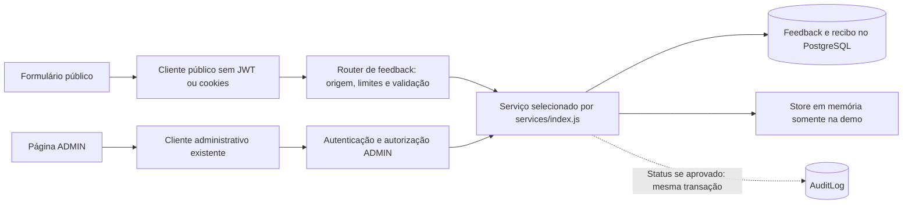

# F1 — Arquitetura do módulo de Feedback

Data: **01/11/2026**, America/Sao_Paulo. Base inspecionada: branch `development/backend`, HEAD `f5f7fb86514345761336833e76b787ff3d9490d7`, antecedido por `79526b2`. Árvore e índice limpos no início; referência local `origin/development/backend` no mesmo commit. Não houve novo fetch nesta etapa.

**Proposta documental para revisão antes da F2. Nenhum modelo, endpoint, formulário, flag ou comportamento descrito como proposto está implementado.** Os limites e prazos abaixo são recomendações de produto e engenharia, sujeitos à aprovação indicada na seção 12.

Referências históricas: [diagnóstico](../reports/diagnostico_dashboard_pos_atualizacao.md), [H1](../reports/historico_alteracoes_h1.md), [H2](../reports/historico_alteracoes_h2.md) e [S1](../reports/estabilizacao_seguranca_ci_s1.md). O checkpoint posterior publicou H1/H2/S1 e confirmou sucesso dos dois jobs na [execução 41377887397](https://github.com/Rafa-A-Brito/portal-PrefGuarulhos/actions/runs/41377887397), vinculada a `f5f7fb8`. Os relatórios anteriores são fotografias de suas etapas e permanecem intactos. As contagens 581 backend/505 frontend são evidências locais de S1; o acesso aos logs completos remotos retornou 403 no checkpoint, impedindo certificar essas contagens como remotas.

## 1. Diagnóstico da árvore atual

| Área inspecionada | Evidência atual | Consequência para Feedback |
| --- | --- | --- |
| [Contato.jsx](../../frontend/src/pages/Contato/Contato.jsx) | Nome/e-mail obrigatórios, assunto e mensagem de até 600 caracteres; submit abre `mailto:`. Não persiste nem comprova envio de e-mail. | Preservar integralmente. Criar fluxo separado, sem importar mensagens anteriores. |
| Canais institucionais no Contato | Há referências a Fala.BR e Ouvidoria; o código informa que o link de Ouvidoria ainda aponta ao portal geral da Prefeitura. | Não apresentar esse link como endereço direto já validado. Encaminhar inicialmente à página Contato e solicitar confirmação institucional dos destinos. |
| [Schema](../prisma/schema.prisma) e `prisma/migrations/` | Não há modelo Feedback. Há 11 migrations, incluindo `AuditLog` na inicial e sessões/métricas nas posteriores. | Precisará de persistência própria e migration nova na F2 aprovada. |
| [Rotas Express](../src/routes/index.js) | Não há rota de feedback; serviços seguem controllers/schemas/seleção real-demo. | Contratos novos, sem ampliar DTOs antigos por conveniência. |
| [Dashboard V1](../../frontend/src/features/admin/pages/AdminDashboard.jsx) | Acervo, quatro gráficos, atalho de Usuários para ADMIN e seção V2 separada. API permite ADMIN/EDITOR. | Feedback terá página/seção administrativa própria e consulta independente. |
| [Dashboard V2](../../frontend/src/features/admin/components/MetricasDashboard.jsx) | Visualizações qualificadas por patrimônio, strings decimais, filtros próprios, favoritos globais indisponíveis. | Não reutilizar unidade, credencial, coleta, denominadores ou flags V2. |
| [AdminLayout](../../frontend/src/features/admin/components/AdminLayout.jsx) e [App](../../frontend/src/App.jsx) | Gestão e Histórico condicionados a ADMIN, além do guard de rota. | Usar o mesmo padrão para `/admin/feedback`. |
| [Autenticação](../src/middlewares/authenticate.js) e [autorização](../src/middlewares/authorize.js) | Bearer, usuário ativo, versão do token, sessão revogada/expirada e perfil; refresh já integrado no cliente admin. | Reutilizar sem alterar a semântica. Guard visual não substitui autorização da API. |
| [Auditoria](../src/utils/auditoria.js) e [serviço de consulta](../src/services/auditoriaService.js) | Ações/entidades/campos permitidos explícitos; escrita com transação do negócio; sanitização reaplicada ao ler. | Status, se aprovado, exige extensão explícita das listas e dos testes; não basta chamar o serviço com uma entidade nova. |
| [Seleção de serviços](../src/services/index.js), [mock](../src/mock/services.js), [runtime](../src/config/runtime.js) | Demo em memória; imports reais não avaliados; `MOCK_DATA=true` proibido em produção. | Adicionar serviço de feedback real/demo na mesma fronteira, sem importar Prisma no ramo mock. |
| [App Express](../src/app.js) | CORS configurado, proxy confiável explícito, parser geral de 100 KB; métricas montadas antes dele com parser próprio de 2 KB. | Montar ingestão de feedback em router próprio antes do parser geral, fora de `/api/metricas`. |
| [Limitador de métricas](../src/middlewares/limiteMetricas.js) | Buckets limitados em memória, HMAC efêmero de rede, expiração; acoplado a identidades e erros de métricas. | Aproveitar o padrão conceitual, não compartilhar quotas/cookies ou importar esse middleware no módulo novo. |
| [Logger](../src/utils/logger.js) e [tratamento de erros](../src/middlewares/errorHandler.js) | Lista positiva de metadados; sem body/stack/SQL arbitrários. Erro de banco não especializado termina em 500. | Traduzir indisponibilidade conhecida em 503 no módulo novo, sem mudar todos os serviços existentes. |
| [CI](../../.github/workflows/predeploy.yml) | Instalação limpa, Prisma, lint, testes, build, audit `high`; PostgreSQL descartável e limpeza própria; sem deploy. | Acrescentar cobertura futura preservando isolamento e limiar. Nenhuma execução iniciada na F1. |

A busca por feedback nos fontes encontrou apenas usos genéricos de retorno visual, como CEP e força de senha. O módulo de avaliação do portal não existe. A inspeção não consultou bancos, ambientes reais ou dados pessoais.

**Dependência de CI identificada:** [validar_metricas_test.js](../scripts/validar_metricas_test.js) compara nomes/checksums e também exige literalmente 11 migrations; [operacaoMetricas.integration.test.js](../test/operacaoMetricas.integration.test.js) exige esse mesmo total. [homologar_auditoria.js](../scripts/homologar_auditoria.js) possui outra conferência desse total, vinculada ao descartável H2. Na F2, uma migration nova exigirá revisar esses consumidores: atualizar a expectativa do trilho corrente mantendo a verificação integral; preservar o ensaio histórico H2 ou criar uma versão específica para a nova base, sem redirecioná-lo silenciosamente para outro banco. Não eliminar checksums nem editar SQL histórico para obter CI verde.

**Dependências de segurança identificadas:** o bootstrap [10-roles.sh](../../infra/postgres/10-roles.sh) concede por padrão SELECT/INSERT/UPDATE/DELETE de novas tabelas à API. As novas tabelas precisarão de restrição específica posterior à criação; o papel já existente não nasce com os privilégios mínimos de Feedback. O [Nginx versionado](../../infra/nginx.conf) possui limites e access log reduzido específicos para métricas, enquanto `/api/` genérico aceita até 12 MB e não define ali o mesmo log reduzido. Não considerar Feedback automaticamente coberto por essas proteções. Planejar e testar regra própria na F4 antes da ativação, sem alterar a hospedagem na F1.

## 2. Finalidade e limites do produto

O feedback serve a identificar dificuldades de navegação, clareza de informações e sugestões sobre o próprio portal. Não é uma avaliação certificada da população, dos visitantes únicos ou do atendimento institucional.

| Canal | Uso | Confirmação oferecida |
| --- | --- | --- |
| Feedback do portal, proposto | Experiência de uso e conteúdo apresentado no site | Recebimento pelo sistema, somente após commit no banco |
| Contato por e-mail, existente | Dúvidas sobre patrimônios, contribuições, pedidos e outros assuntos já listados | Abertura do aplicativo de e-mail; comportamento atual preservado |
| Ouvidoria/atendimento institucional | Reclamação formal, denúncia, solicitação de serviço ou acesso à informação | Regras e protocolo do canal competente, fora deste módulo |

Texto proposto: **“Ajude a melhorar este portal. Envie um elogio, sugestão ou problema de uso. Este formulário não gera protocolo de atendimento e não substitui a Ouvidoria. Para denúncias, reclamações formais ou pedidos de atendimento, consulte os canais de contato.”** Link para `/contato`, sem transferência automática da mensagem.

Não coletar anexos, localização do visitante, URL completa/referrer, identificador de sessão, patrimônio visitado, favoritos, IP persistente ou fingerprint. Não inferir tipo, satisfação, urgência ou intenção por IA. O tipo é selecionado pela pessoa. Não publicar comentários, enviar e-mails automáticos ou abrir tickets institucionais nesta proposta.

## 3. Arquitetura e ativação propostas



Propor `FEEDBACK_RECEBIMENTO_ATIVO=false` e `FEEDBACK_CONSULTA_ATIVA=false` no backend e `VITE_FEEDBACK_ATIVO=false` para a descoberta do formulário. São nomes novos propostos, não variáveis criadas nesta entrega. A API é autoridade; a flag compilada do frontend não concede permissão nem comprova disponibilidade. Consulta desativada não interrompe a política de descarte. Recebimento pode ser suspenso enquanto ADMIN continua consultando registros retidos.

Rotas públicas e administrativas usarão o serviço `feedback` selecionado em `services/index.js`. Métodos previstos: receber, listar, detalhar e resumir; atualizar estado apenas na variante aprovada. SQL parametrizado/Prisma, seleção explícita de campos e transações curtas. Leitura administrativa com `RepeatableRead` e `READ ONLY` nas consultas compostas; timeout proposto de 5 segundos e limites de paginação/intervalo. Não consultar tabelas inteiras no navegador.

A API pública será acessada por `/api/feedback` na mesma origem do portal, com proxy local de desenvolvimento quando necessário. O cliente próprio usará `credentials: "omit"`, `cache: "no-store"`, `redirect: "error"`, sem importar `services/api.js`, sem refresh, cookie de métricas ou vínculo com login. A administração reutilizará `api.js`, com Bearer e renovação existentes. Não criar mecanismo alternativo de sessão.

## 4. Formulário público e proposta visual

Recomenda-se uma página `/feedback`, descoberta por link discreto “Avaliar o portal” no rodapé. Sem pop-up automático, botão flutuante adicional, alteração do formulário Contato ou interrupção da navegação.

```text
Avaliar o portal
[finalidade, limites e link para Contato]

Tipo de feedback *
( ) Elogio   ( ) Sugestão   ( ) Problema

Comentário *                         0/2000
[texto em várias linhas                   ]
[                                         ]
Não inclua senhas, documentos ou dados sensíveis.

[aviso de privacidade e prazo aprovado]
[Enviar feedback]
[mensagem de erro ou confirmação acessível]
```

| Campo | Proposta para o MVP | Regra |
| --- | --- | --- |
| Tipo | Obrigatório, sem seleção inicial | `ELOGIO`, `SUGESTAO`, `PROBLEMA`; rótulos traduzidos na UI |
| Comentário | Obrigatório | 1–2.000 pontos de código Unicode após normalização NFC, CRLF→LF e trim externo; rejeitar vazio e controles incompatíveis, preservar parágrafos |
| Nota | **Não incluir no MVP recomendado sem aprovação** | Se aprovada: pergunta “De 1 a 5, qual sua satisfação com a experiência de uso deste portal?”, 1 muito insatisfeito a 5 muito satisfeito; resposta opcional e sem valor inicial |
| Nome/e-mail | **Não coletar no MVP recomendado** | Só adicionar após finalidade de retorno, responsável pelo atendimento e prazo definidos. Continuariam opcionais; validação de e-mail não comprova titularidade. |
| Aviso | Obrigatório na apresentação | Versão exata aceita pelo servidor; versão não é consentimento jurídico certificado nem autorização irrestrita para novos usos |

O contador deve aplicar a mesma unidade da validação do servidor; não depender apenas de `maxlength`/`.length`, que contam unidades UTF-16. Limite também em bytes no transporte. A F3 deve testar emoji, acentos combinados, colagem e quebras de linha.

Usar tokens e tipografia do portal, formulário de uma coluna, rótulos visíveis, `fieldset/legend` para os tipos, texto de ajuda associado, foco evidente, erros junto aos campos e resumo com foco no primeiro erro. Não depender só de cores. Botão com estado “Enviando…” e prevenção de duplo clique. Verificar contraste, zoom 200%, teclado, leitor de tela e largura de 320 px; viewport simulado não substitui aparelho físico.

Estados: pronto, validação local, enviando, recebido, limite temporário, desativado, erro e resultado incerto. Em rede/timeout, preservar o texto e a chave do envio; informar “Não foi possível confirmar o recebimento” e permitir reenvio explícito idempotente. Cancelar fetch não desfaz commit. Após confirmação válida da API: limpar comentário/chave e mostrar “Feedback recebido. Obrigado por ajudar a melhorar o portal.” Não prometer resposta, resolução, anonimato absoluto ou protocolo.

Nenhum envio de texto durante digitação, abertura da página, navegação ou troca de tipo. Sem gravação automática do rascunho em localStorage/sessionStorage, analytics de formulário ou fila offline. O rascunho e a chave permanecem apenas na memória da aba; fechar/recarregar pode perdê-los, limitação que deve ser informada quando o resultado do envio for incerto.

## 5. Modelo de dados proposto

**Exemplo arquitetural, não adicionar ao schema na F1.** UUID e timestamps seguem as convenções atuais; nomes SQL em snake_case. O recibo separado permite descartar metadados de idempotência antes do texto e preservar a confirmação de um envio mesmo se seu registro for removido legitimamente.

```prisma
enum TipoFeedback {
  ELOGIO
  SUGESTAO
  PROBLEMA

  @@map("tipo_feedback")
}

model Feedback {
  id           String         @id @default(dbgenerated("gen_random_uuid()")) @db.Uuid
  tipo         TipoFeedback
  mensagem     String         @db.VarChar(2000)
  avisoVersao  String         @map("aviso_versao") @db.VarChar(40)
  createdAt    DateTime       @default(now()) @map("created_at") @db.Timestamptz(3)
  expiraEm     DateTime       @map("expira_em") @db.Timestamptz(3)
  recibo       ReciboFeedback?

  @@index([createdAt(sort: Desc), id(sort: Desc)], map: "feedback_data_id_idx")
  @@index([tipo, createdAt(sort: Desc), id(sort: Desc)], map: "feedback_tipo_data_id_idx")
  @@index([expiraEm, id], map: "feedback_expiracao_idx")
  @@map("feedback")
}

model ReciboFeedback {
  chaveDigest    String    @id @map("chave_digest") @db.Char(64)
  conteudoDigest String    @map("conteudo_digest") @db.Char(64)
  versaoChave    String    @map("versao_chave") @db.VarChar(40)
  feedbackId     String?   @unique(map: "feedback_recibo_registro_key") @map("feedback_id") @db.Uuid
  recebidoEm     DateTime  @default(now()) @map("recebido_em") @db.Timestamptz(3)
  expiraEm       DateTime  @map("expira_em") @db.Timestamptz(3)
  feedback       Feedback? @relation(fields: [feedbackId], references: [id], onDelete: SetNull)

  @@index([expiraEm], map: "feedback_recibo_expiracao_idx")
  @@map("feedback_recibo")
}
```

`expiraEm` é calculado exclusivamente no servidor a partir do instante transacional, nunca recebido do cliente. Proposta: Feedback por **180 dias** desde criação, recibo por **24 horas** desde recebimento. Não renovar os prazos ao consultar, reenviar ou alterar estado. A transação usa um mesmo instante para a data do Feedback e o recibo, garantindo a repetição da confirmação original.

Constraints SQL adicionais na **nova** migration futura: `char_length(btrim(mensagem)) BETWEEN 1 AND 2000`; aviso não vazio; `expira_em > created_at`/`recebido_em`; digests hexadecimais de 64 caracteres. A API faz a normalização e validação mais estritas; CHECK não substitui o schema HTTP. Não indexar texto livre nem criar full-text, índices por pessoa ou agregados permanentes antes de necessidade medida. Medir os índices propostos em base sintética representativa.

Não há FK com `User`, sessão, patrimônio ou credencial de métricas. A relação opcional do recibo não é uma identidade de visitante. UUID é endereço técnico de registro administrativo, não um segredo de acesso.

**Variantes condicionais, fora do modelo base acima:**

- Nota aprovada: acrescentar `nota Int? @db.SmallInt`, CHECK `nota IS NULL OR nota BETWEEN 1 AND 5`; rejeitar zero, decimais e coerção de string. Adicionar a pergunta/versão de aviso correspondente e contrato opcional `nota`. Ausência é null; não transformar em 0.
- Tratamento aprovado: acrescentar enum `EstadoFeedback { NOVO EM_ANALISE CONCLUIDO }`, `estado` default `NOVO`, `versao Int @default(1)` e `updatedAt` com fuso. CHECK de versão positiva; índice `(estado, createdAt DESC, id DESC)` somente se o filtro estiver aprovado. Concluído significa triagem encerrada, não problema corrigido. Sem responsável atribuído, comentários internos, SLA, prioridade inferida ou categoria SPAM no primeiro desenho.
- Contato para retorno: exige revisão do modelo e dos DTOs antes de implementação. Nome/e-mail não ficam reservados como campos vazios “para o futuro”. Aprovar prazo próprio e acesso restrito; jamais copiá-los para recibo, agregados ou AuditLog.

## 6. Contratos HTTP propostos

Todos são novos. Usar o envelope existente `{ success, data }`; falhas com `{ success:false, message, error:{code,message} }` e, apenas para validação, `details:[{field,message}]` controlados, sem eco do valor enviado. Datetimes de resposta em ISO UTC com `Z`; apresentação administrativa no fuso paulista.

### 6.1 Recebimento público

`POST /api/feedback`

Headers obrigatórios: `Content-Type: application/json`, `X-Portal-Feedback: 1`, `Idempotency-Key` aleatória de 32 bytes codificados em base64url sem padding (43 caracteres), `Origin` correspondente à origem permitida. Chave gerada por Web Crypto somente ao iniciar envio explícito; exemplo abaixo não contém chave utilizável.

```json
{
  "tipo": "SUGESTAO",
  "mensagem": "Gostaria de encontrar a busca com mais facilidade.",
  "avisoVersao": "feedback-v1"
}
```

Objeto estrito: rejeitar propriedades extras, arrays, null, tipos inválidos, data/ID/estado enviados pelo cliente. `avisoVersao` deve pertencer ao conjunto aceito da configuração de feedback, não apenas respeitar tamanho. Mudança de aviso incompatível gera 409 `AVISO_DESATUALIZADO`; preservar texto e solicitar revisão do novo aviso antes de novo envio. Uma repetição já confirmada e ainda válida pode usar sua versão original para obter a confirmação, sem nova coleta.

Primeiro commit: **201**. Replay confirmado do mesmo envio: **200**, mesma resposta de negócio:

```json
{
  "success": true,
  "data": {
    "recebido": true,
    "recebidoEm": "2026-11-01T15:00:00.000Z"
  }
}
```

Data meramente ilustrativa. Não retornar mensagem, contato, UUID administrativo, classificação adicional ou link público de consulta. Não criar endpoint público de lista, detalhe, busca por chave, status ou exclusão. O recibo confirma recebimento histórico, não permanência ou leitura pela equipe.

### 6.2 Idempotência e concorrência

1. Validar origem, método, limites, formato da chave e estrutura do corpo. Gerar `chaveDigest = SHA-256(chave aleatória)`; a chave não é ID de pessoa, não pode ser reutilizada para mensagens distintas e não deve ir para URL/log.
2. Canonicalizar uma tupla ordenada com versão do contrato, tipo, mensagem normalizada, aviso e nota somente na variante aprovada. Usar HMAC-SHA-256 dessa tupla para `conteudoDigest`, com segredo **próprio de feedback**, fora do documento e sem reutilizar JWT/métricas. HMAC reduz a possibilidade de testar comentários previsíveis a partir de um vazamento isolado de digests; não anonimiza a mensagem armazenada no Feedback.
3. Criar Feedback e recibo na mesma transação. A unicidade de `chaveDigest` é a autoridade entre processos. Duas requisições concorrentes não podem criar dois feedbacks. Se a unicidade falhar, abortar toda a transação antes de consultar o recibo vencedor em nova leitura; não continuar em transação PostgreSQL abortada.
4. Recibo válido e corpo equivalente: responder 200 sem novo INSERT e sem incrementar gráficos. Mesma chave/corpo diferente: 409 `CHAVE_REUTILIZADA`, sem revelar o corpo anterior. Timeout de lock/transação: 503; cliente conserva a chave e não assume sucesso ou falha definitiva.
5. Versionar o segredo HMAC; novos recibos usam a chave atual, replays usam a versão registrada. Manter versões antigas até o fim dos recibos correspondentes. Versão indisponível é falha de serviço, nunca permissão para aceitar duplicata. Rotação e limpeza de chaves entram no plano operacional, sem instalação nesta fase.
6. Dentro das 24 horas, permitir replay de recibo confirmado mesmo com recebimento suspenso, após controles de origem/abuso; nova chave continua recebendo 503 `FEEDBACK_DESATIVADO`. Não converter replay em aceitação de nova mensagem. Essa leitura mínima de recibo não depende da flag administrativa.
7. Recibo expirado ainda presente: 409 `ENVIO_EXPIRADO`, não substituir automaticamente. Após descarte, a chave não é reconhecível; a garantia é **limitada a 24 horas**, não deduplicação eterna. O cliente bloqueia reenvio automático e, ao expirar sua janela, explica a incerteza antes de permitir uma nova submissão deliberada. Outra chave, outro navegador ou recarga podem produzir nova contribuição; não chamar isso de visitante único.

Quando o resultado anterior for incerto, oferecer “Reenviar o mesmo feedback” sem editar o payload pendente. Para editar, exigir abandono explícito desse envio e informar que o anterior pode ter sido recebido. Não deduplicar mensagens diferentes pelo texto: pessoas distintas podem enviar comentários iguais.

### 6.3 Consultas administrativas

Todas exigem `authenticate` e `authorize("ADMIN")`, inclusive resumo. Aplicar `Cache-Control: private, no-store` antes de parser/autenticação para cobrir erros. Sem endpoint aberto de estatísticas. EDITOR recebe 403; sessão ausente/inválida recebe 401; não consultar registros antes dessa decisão.

| Método e caminho | Query/body | Resposta proposta |
| --- | --- | --- |
| `GET /api/admin/feedback` | `inicio`, `fim`, `tipo?`, `pagina=1`, `limite=20`; `estado?` só na variante | `{disponivel:true,meta,itens,paginacao}` |
| `GET /api/admin/feedback/resumo` | `inicio`, `fim`, `tipo?`, `granularidade=dia`; `estado?` só na variante | `{disponivel:true,meta,total,porTipo,serie,notas}` |
| `GET /api/admin/feedback/:id` | UUID estrito; nenhuma query | `{disponivel:true,registro:{id,tipo,mensagem,avisoVersao,createdAt,expiraEm}}`; nota/estado/versão apenas quando aprovados |
| `PATCH /api/admin/feedback/:id/estado` | **Somente se aprovado:** `{estado,versaoEsperada}` | Estado e versão confirmados após commit; regras na seção 9 |

Registrar `/resumo` antes de `/:id`. Montar router administrativo antes de routers abrangentes de `/admin`. Não adicionar `/feedback` sob `/api/metricas`, cujo router possui validação e 404 próprios.

`inicio`/`fim` obrigatórios em `YYYY-MM-DD`, inclusivos como dias civis de `America/Sao_Paulo`, até 366 dias e sem fim futuro. Internamente usar `createdAt >= inícioDoDia(inicio)` e `< inícioDoDia(diaSeguinte(fim))` calculados pela zona IANA, sem fixar -03:00 nem depender do fuso do host. Tipos enum estritos; período invertido, data inexistente, arrays, parâmetros desconhecidos e combinações não suportadas retornam 400. “Categoria” na UI significa **tipo de feedback**, não categoria de patrimônio.

Paginação: página inteira 1–10.000, limite 1–100. Ordem `createdAt DESC, id DESC`. Lista e contagem na mesma fotografia; `paginacao:{pagina,limite,total,totalPaginas}`, números inteiros seguros e `totalPaginas=ceil(total/limite)`; página além do fim retorna itens vazios e total real. Se a contagem exceder inteiro seguro, falhar de forma controlada, nunca arredondar. A lista contém apenas `id,tipo,createdAt` e campos opcionais aprovados de nota/estado/versão; mensagem completa, aviso e prazo somente no detalhe. Sem prévia de texto pessoal em todas as linhas, exportação CSV ou busca global de texto livre no MVP.

Resumo: `total` e todas as quantidades em strings decimais, sem arredondar BigInt. `porTipo` sempre lista os três tipos com seus valores no mesmo recorte; ao filtrar um tipo, os demais têm zero no recorte filtrado. `serie` traz `{periodo:"YYYY-MM-DD" ou "YYYY-MM",quantidade:"...",parcial:boolean}`. `granularidade` aceita somente `dia` ou `mes`, máximo de 366 dias mesmo no modo mensal. Meses cortados pelo filtro e dia corrente são parciais; não somar dias fora do intervalo para completar um mês.

`meta` contém `inicio,fim,fuso,geradoEm,tipo` (null sem filtro), `base:"REGISTROS_RETIDOS"`, `unidade:"FEEDBACK_RECEBIDO"`, `retencaoDias` e `recorteLimitadoPorRetencao`; no resumo, também `granularidade`. Estado só aparece se implementado. Consultar apenas registros ainda dentro do prazo em um instante de referência único. Nunca misturar registros reais com fixtures demo. Soma de tipos = total = soma dos períodos. Contagem global vem do servidor, não da soma da página.

`notas:{disponivel:false}` enquanto a coleta não for aprovada. Se aprovada: `{disponivel:true,totalComNota:"...",semNota:"...",distribuicao:[{nota:1,quantidade:"..."},...,{nota:5,quantidade:"..."}]}`; soma das cinco notas = totalComNota e totalComNota + semNota = total. Não inferir nota do texto, tipo ou status; não chamar nota ausente de insatisfação. Média e ranking de satisfação não são necessários ao MVP.

Consulta desativada: após autenticação/autorização e validação, GETs retornam 200 `{success:true,data:{disponivel:false,motivo:"DESATIVADA"}}`, sem consultar tabelas de feedback. Detalhe ativo de registro ausente, eliminado ou expirado: 404 genérico. PATCH desativado: 503, sem escrita. Quando apenas o recebimento estiver desligado, a consulta pode continuar habilitada.

### 6.4 Falhas e indisponibilidade

| Status/código | Uso | Comportamento esperado |
| --- | --- | --- |
| 400 `BAD_REQUEST` | Corpo, UUID, filtros ou chave malformados | Corrigir campos; sem eco da mensagem |
| 401/403 | Sessão/perfil admin ou origem pública recusada | Nenhum dado; código público `ORIGEM_INVALIDA` para origem |
| 404 `NOT_FOUND` | Detalhe autorizado inexistente/expirado | Mensagem própria, sem expor distinção de exclusão |
| 409 | `CHAVE_REUTILIZADA`, `ENVIO_EXPIRADO`, `AVISO_DESATUALIZADO` ou `VERSAO_CONFLITANTE` | Explicação específica; não reenviar automaticamente com nova chave/versão |
| 413/415 | Corpo acima do limite / mídia ou codificação inválida | Recusa antes da persistência |
| 429 `TOO_MANY_REQUESTS` | Quota excedida | `Retry-After` em segundos; conservar rascunho/chave |
| 503 `FEEDBACK_DESATIVADO` | Novo envio suspenso | Estado desativado, sem prometer retry em prazo fixo |
| 503 `FEEDBACK_INDISPONIVEL` | Falha conhecida de conexão/timeout/lock | `Retry-After` curto, proposto 5 s; sem sucesso/zero fabricado |
| 500 `INTERNAL_ERROR` | Falha inesperada | Erro genérico, sem stack/SQL; diagnóstico somente por metadados controlados |

Definir erros locais compatíveis com `BaseError` para preservar os códigos. HTTP 503 não prova rollback se a conexão caiu após commit; por isso a idempotência é necessária. Lista/resumo com falha não devolvem coleção vazia ou zero. O 500 observado na H2 permanece comportamento histórico da auditoria; esta proposta de 503 pertence ao módulo novo.

## 7. Segurança, abuso e privacidade

### 7.1 Ordem e limites da ingestão

Antes do parser geral: cache `no-store`, validação de método/origem/transporte, quota, verificação de mídia, `express.json({limit:"16kb",inflate:false})`, DTO estrito e serviço. Limite de 16 KB comporta 2.000 caracteres multibyte e JSON, mas não garante aceitar toda representação exageradamente escapada; excesso recebe 413. Rejeitar formulários URL-encoded, multipart, `text/plain`, arrays, corpos comprimidos e cabeçalhos duplicados/ambíguos. Caminhos desconhecidos ficam no 404 do router público, sem cair no parser geral permissivo. OPTIONS é preflight, nunca gravação.

Origem pública exata e header próprio obrigatórios; rejeitar Origin ausente/`null`, origem divergente e `Sec-Fetch-Site: cross-site`. Se Fetch Metadata não existir, manter validação Origin/header como condição necessária. Conferir host/transporte contra configuração conhecida, não confiar em headers encaminhados de qualquer cliente. HTTPS obrigatório no ambiente publicado; loopback explicitamente separado para testes. Não alterar `trust proxy` global para aceitar qualquer origem de tráfego.

O endpoint não usa autoridade de cookie ou sessão da vítima. Origin, JSON e header não simples dificultam submissão induzida por outro site, mas **não autenticam humanos nem bloqueiam clientes HTTP que forjem headers**. CORS sozinho não impede escrita. A defesa proposta combina essas camadas com quotas; a referência conceitual é a [orientação OWASP sobre CSRF](https://cheatsheetseries.owasp.org/cheatsheets/Cross-Site_Request_Forgery_Prevention_Cheat_Sheet.html), especialmente verificação de origem e requisições não simples. Não importar a credencial de participação V2 como requisito de feedback.

Proposta inicial de quotas por processo: 5 tentativas por minuto e 20 por hora por rede, mais teto global de 60 tentativas por minuto para a rota. Contam replays e rejeições que passam pelo limitador. Derivar bucket por HMAC com segredo efêmero, normalizando IPv4/IPv6 e agrupando IPv6 /64, sem escrever IP ou digest em banco/log; expirar em até uma hora, máximo 10.000 entradas. Saturação recusa novas chaves com 429, não cresce memória indefinidamente. IP é apenas sinal transitório de abuso, não identidade persistente.

Esses valores são hipóteses de operação a validar: redes compartilhadas podem sofrer bloqueio coletivo; bots distribuídos podem ultrapassar a defesa. Reinício zera buckets e múltiplas réplicas multiplicam quotas. Antes de ativar em múltiplas réplicas, aprovar limitador compartilhado ou borda com retenção limitada e sem logs de IP para esse fluxo; não instalar Redis/CAPTCHA/serviço externo por antecipação. Manter chave de desligamento de recebimento e limites de timeout/conexões. Não usar fingerprint, prova de humanidade por tempo de digitação ou classificação automática do comentário.

### 7.2 Texto, permissões e logs

Exibir texto com escape normal do React, sem HTML/Markdown executável, `dangerouslySetInnerHTML`, embeds, preview automático de URL ou fetch de links enviados. Texto de usuário é dado, inclusive quando contém instruções. Parâmetros de ordenação e filtro são enumerados; consultas parametrizadas, sem SQL interpolado de texto. Não tornar feedback conteúdo público.

UUID não protege contra enumeração por si só. Todas as leituras, inclusive estatísticas e detalhe inexistente, passam primeiro por ADMIN. Não expor IDs internos na resposta pública, nem diferenciar e-mail existente/inexistente. A chave aleatória de idempotência não habilita consulta de texto e não deve servir de token de leitura. Qualquer pessoa com essa chave e o corpo consegue repetir sua confirmação durante a janela; ela deve permanecer fora de logs e URLs.

Logar apenas evento controlado, requestId, status, rota template e, na operação ADMIN, ator/ID/ação já permitidos. Nunca body, comentário, nome/e-mail, nota vinculada ao texto, cabeçalho Idempotency-Key, HMAC/digest, cookie, JWT, IP, query arbitrária ou objeto de erro completo. Sucesso operacional somente após commit; falha do destino de logs não transforma commit em erro. A [orientação OWASP de logging](https://cheatsheetseries.owasp.org/cheatsheets/Logging_Cheat_Sheet.html) fundamenta excluir dados sensíveis e proteger o ciclo de vida dos logs; as listas locais deverão ser testadas também para erros de validação e banco.

Revisar logs de proxy, hospedagem e ferramentas de erro antes da ativação: a ausência de IP no banco não garante ausência em access logs. Não prometer “anônimo” se texto livre ou infraestrutura puderem identificar a pessoa. Incluir aviso para não enviar senhas, documentos, dados sensíveis ou informações de terceiros. Não tentar anonimização automática como substituto de minimização.

### 7.3 Retenção, exclusão e governança

Recomendação para aprovação institucional: mensagem e metadados de Feedback por 180 dias; recibos por 24 horas; logs operacionais próprios de feedback por até 30 dias, sem texto; backups contendo feedback com ciclo máximo proposto de 30 dias. Esses prazos não são lei nem política vigente. Responsável pelo tratamento, finalidade institucional, texto do aviso, fundamento aplicável e atendimento aos titulares precisam ser definidos pela instituição; esta arquitetura não certifica conformidade jurídica.

Consulta exclui logicamente registros vencidos pelo prazo, mesmo que a limpeza tenha atrasado. Rotina futura remove fisicamente vencidos em lotes limitados, com destino conferido, modo prévio READ ONLY, backup conforme política aprovada e papel operacional dedicado; não reutilizar automaticamente o operador das métricas. Medir atraso do descarte sem contar mensagens em logs. Agendamento somente em autorização posterior; não deixar a retenção depender de alguém abrir a página.

Sem soft delete indefinido ou cópia de texto em auditoria. Não criar DELETE público. Solicitação individual de exclusão será tratada por procedimento institucional com verificação proporcional e acesso autorizado; a ausência de identificação voluntária limita a possibilidade de localizar/atribuir uma mensagem. Não exigir novos documentos de identidade para compensar essa escolha técnica. Remoção autorizada deve invalidar leitura e agregados, mantendo apenas o recibo mínimo até seu prazo quando necessário; FK SetNull evita reter o comentário pelo recibo.

Agregados são calculados dos registros retidos, não uma segunda base eterna. Excluir um registro reduz os resultados subsequentes; datas fora da retenção não significam que nunca houve envios. Backups exigem controle de acesso, expiração e procedimento de restauração que reaplique descarte e remoções autorizadas antes de reabrir o serviço. Se houver manifesto de exclusões para restauração, conter somente IDs necessários, acesso restrito e prazo vinculado ao último backup, sem mensagens. Política de retenção de AuditLog continua separada; o módulo não elimina auditoria histórica automaticamente.

## 8. Dashboard e consultas de Feedback

Página proposta `/admin/feedback`, menu “Feedback do portal” no grupo Gestão, somente ADMIN. Reutilizar cabeçalho, filtros, tabela, paginação e padrão de detalhe do Histórico/Usuários; gráficos com Recharts já instalado, carregados sob demanda. V1 e V2 permanecem com seus quatro e três gráficos e contratos atuais. Um erro de feedback não pode derrubar essas seções.

```text
Feedback do portal
Registros recebidos e ainda retidos — horário de São Paulo
[Data inicial] [Data final] [Tipo: todos] [Dia/Mês] [Aplicar] [Limpar]
Total no período e filtros: 27                         (exemplo sintético)
[Barras: elogio / sugestão / problema] [Evolução temporal]
[Distribuição 1–5 somente se a pergunta for aprovada]
[Tabela acessível dos valores dos gráficos]

Recebido em          Tipo          [Estado, se aprovado]     Detalhes
...                  ...          ...                       [Abrir]
[Página anterior] Página 1 de N [Próxima página]
```

Um único total textual de destaque; sem cards de visitantes, usuários únicos, conversão ou “satisfação geral”. Distribuição de tipos e série temporal respondem perguntas distintas. Não usar gráfico de pizza adicional com os mesmos valores. Nota, se aprovada, tem denominador explícito e opção não respondida; quem envia feedback não representa todos os visitantes.

Período inicial proposto: últimos 30 dias civis, incluindo hoje; limpar restaura esse recorte e todos os tipos. Aplicar filtros volta à página 1. Lista e resumo usam a mesma consulta aplicada, com metadados comparados pelo cliente; respostas atrasadas são canceladas/descartadas. Cada endpoint produz sua fotografia coerente, mas **não se promete transação única entre duas requisições HTTP**: novos envios entre elas podem alterar totais. Mostrar `geradoEm` e permitir atualizar ambos; não ajustar contagens artificialmente para esconder a diferença.

Detalhe só ao abrir, com modal/painel acessível, Escape, contenção/restauração de foco, leitura de texto extenso e nenhum valor de outro registro por resposta atrasada. Mensagem não aparece em título de janela, URL ou logs. Não buscar todos os detalhes para filtrar localmente.

| Estado | Apresentação |
| --- | --- |
| Carregando | Mensagem/skeleton acessível, sem substituir total por zero |
| Vazio | “Nenhum feedback retido neste período e filtros”; zero é contagem desta base, não de visitantes |
| Desativado | Texto próprio; não apresentar gráficos zerados |
| Erro recuperável | Manter filtros, nova tentativa; dados anteriores, se visíveis, rotulados desatualizados |
| Sessão encerrada / sem permissão | Fluxo existente de autenticação e 401/403; não exibir dados anteriores |
| Detalhe removido / expirado | 404 próprio; lista pode ter envelhecido desde a consulta |
| Retenção / dia parcial | Aviso de recorte e parcialidade; não chamar ausência histórica de ausência de participação |

Buckets vazios podem receber zero **somente como contagem de registros retidos**, em consulta concluída. Não converter erro/lacuna de disponibilidade em zero de recebimentos históricos. Números exatos em tabela; se excederem faixa segura para desenho, omitir gráfico com explicação e manter as strings formatadas. Nenhum total estimado no lugar de falha de banco.

## 9. Auditoria e tratamento administrativo opcionais

**Mínimo privilégio recomendado:** ADMIN consulta lista, detalhe e agregados; EDITOR não acessa nem totais, pois a atividade editorial não exige ler comentários potencialmente pessoais. Eventual permissão de EDITOR requer finalidade e revisão próprias, não herdar automaticamente a permissão V1/V2.

MVP base é somente recebimento e consulta. Se o estado for aprovado, permitir `NOVO → EM_ANALISE → CONCLUIDO` e reabertura `CONCLUIDO → EM_ANALISE`; outras transições retornam 409. Não alterar mensagem/tipo/nota na triagem, pois mudaria o significado das estatísticas. Estado não implica resposta enviada nem correção concluída.

PATCH exige `versaoEsperada` inteira positiva. Na mesma transação: verificar estado e versão atuais, atualizar condicionalmente e incrementar versão; inserir `AuditLog` com `action:"FEEDBACK_STATUS_UPDATE"`, `entity:"Feedback"`, `entityId` do feedback, ator de `req.user.id`, `oldValues:{estado:...}` e `newValues:{estado:...}`. Falha na auditoria provoca rollback do estado. Versão conflitante: 409 sem sobrescrever alteração concorrente; UI recarrega detalhe e exige nova decisão. Mesmo estado/versão atual é no-op e não gera evento. Reenvio de versão antiga não gera segunda mudança; após resposta incerta consultar detalhe/histórico antes de tentar de novo.

Extensões futuras necessárias: `AUDIT_ENTITIES`, `AUDIT_ACTIONS`, allowlist de campos, rótulo do resumo, formatador H1 e opções de filtros. A allowlist de Feedback será **apenas estado**, sem mensagem, nota, chave/digest, aviso ou contato. Preservar ações e formato dos eventos existentes, sanitização na leitura, fallback de código desconhecido e identidade atual do ator. ID sem registro após descarte continua renderizável no Histórico.

O POST público não é ação de ADMIN e não deve usar ator fictício, usuário de sistema ou sessão do visitante no AuditLog. Recebimento é evidenciado pelo Feedback/recibo e log operacional sem conteúdo. Consultas não devem ser transformadas em “alterações” no histórico. Descarte automático usa evidência operacional de lote sem texto; uma eventual exclusão manual auditada exigiria contrato próprio, fora do PATCH de estado.

## 10. MOCK_DATA e estratégia de testes futura

Adicionar `src/mock/feedback.js`, coleção própria no store e export em `mock/services.js`. Reproduzir o mesmo DTO, validação de filtros, ordenação estável, regras de nota/estado aprovadas e janela de idempotência. Usar relógio injetável, segredo efêmero e serialização de operações em memória para testes determinísticos; nada de chamadas PostgreSQL no mock. Não carregar dados reais ou dumps em fixtures.

Mostrar **“Demonstração — dados fictícios, descartados ao reiniciar”** na página e nas confirmações demo; nunca confirmar “gravado no banco” nesse modo. Propor metadado controlado `demonstracao:true` nas respostas novas de feedback quando `MOCK_DATA` estiver ativo, inclusive recebimento. Modo real não recebe esse sinal do cliente. A demo continua proibida em produção. Seu recebimento pode ser habilitado apenas no processo demonstrativo, sem alterar flags/exemplos do modo real.

Fixtures: três tipos, períodos distintos, texto extenso/malicioso, Unicode, intervalos vazios e, somente se aprovados, notas ausentes/1–5 e estados. Sem nomes/e-mails reais, tokens ou chaves fixas de produção. Dados demo não entram no resumo real. Testes de store em memória não homologam unicidade, isolamento, transações ou concorrência PostgreSQL.

| Grupo de aceitação futuro | Casos mínimos |
| --- | --- |
| Recebimento/validação | Campos extras, tipos inválidos, vazio, 2.000/2.001 pontos de código, Unicode/NFC, controles, limites de bytes, aviso desatualizado, datas/estado injetados |
| Idempotência PostgreSQL | Duplo clique e concorrência com mesma chave, corpo diferente, duas instâncias, resposta perdida após commit, rollback sem órfãos, timeout, replay após restart, rotação HMAC, janela/expiração e suspensão do recebimento |
| Segurança | Origin ausente/null/divergente, JSON/mídia/codificação, preflight, quotas IPv4/IPv6/NAT, memória cheia, proxy não confiável, nenhum JWT/cookie no cliente público, logs sem conteúdo |
| Permissões/sessões | ADMIN/EDITOR/visitante, rota direta, 401/403 antes da leitura, login/refresh/logout e cache também nas falhas |
| Consulta/gráficos | Mesmo recorte/total, ordem por data/ID, paginação, mudança de filtro, timestamps paulistas/transições históricas, dia/mês parcial, retenção, zeros de base retida, BigInt e nota ausente |
| Erros/concorrência UI | Loading, vazio, desativado, 400/404/409/429/503, retry explícito com mesma chave, abort e respostas atrasadas, lista/resumo em instantes distintos |
| Status, se aprovado | Transições, conflito de versão, no-op, replay, falha de INSERT audit e rollback real; histórico sem texto e registro já excluído |
| Retenção/privilégios | Remoção por lote/corte, recibos vencidos, FK SetNull, privilégios mínimos, atraso de job, restauração sintética reaplicando descarte, nenhum conteúdo em logs |
| Interface | Teclado, foco, Escape, leitor de tela, contraste, zoom, 320/390/1440 px, texto longo e aparelhos físicos disponíveis |
| Regressões | H1/H2, V1/V2, autenticação, regiões, mídia, favoritos locais, participação e Contato por e-mail inalterados |

F2/F4 devem usar PostgreSQL **descartável novo e identificado**, com autorização própria de escrita, schema inicial conferido, migrations novas e históricas, checksums preservados, papéis restritos e backup apropriado antes de fixtures. Falha de escrita não autoriza reset, reparo ou repetição automática. Aplicar migration novamente sem pendência é teste previsto, não editar migration histórica. Não usar `patrimonio_guarulhos`, Compose normal ou bancos H2/S1 por conveniência.

## 11. Entregas, arquivos previstos e dependências

Os caminhos abaixo são planejamento; não foram criados nesta etapa, exceto este documento.

| Etapa | Arquivos/áreas previstos | Dependências e saída para revisão |
| --- | --- | --- |
| F1 — esta entrega | `backend/docs/feedback_fase_f1_arquitetura.md` | Diagnóstico, decisões e contratos; revisão antes de código |
| F2 — backend e segurança | `backend/prisma/schema.prisma`, migration nova `prisma/migrations/<timestamp>_add_feedback/migration.sql`; `src/config/feedback.js`, `schemas/feedbackSchema.js`, `routes/feedbackRoute.js`, `routes/adminFeedbackRoute.js`, `controllers/feedbackController.js`, `services/feedbackService.js`, `middlewares/limiteFeedback.js`; integração em `app.js`, `routes/index.js`, `services/index.js`; `mock/feedback.js`, store/exports; OpenAPI em `src/docs/` | Aprovar campos, retenção, idempotência, flags e exclusividade do banco de teste. DTOs/constraints/privilégios coerentes, nenhuma nova dependência presumida |
| F2 — validação e descarte | `backend/test/feedback.test.js`, `feedback.integration.test.js`, `feedbackSeguranca.test.js`, `test/fixtures/feedback.mjs`; `backend/scripts/descartar_feedback.js`, `scripts/sql/permissoes_feedback.sql`; revisão explícita dos consumidores de migrations | Testes novos descobertos pelo runner, rotina de descarte sem agendamento instalado, relógio controlado e prova de atomicidade real |
| F3 — formulário | `frontend/src/pages/Feedback/Feedback.jsx`, `Feedback.module.css`, `services/feedbackPublicoApi.js`; rota em `App.jsx`, link em `components/Footer/Footer.jsx`; `frontend/test/Feedback.test.jsx`, `feedbackPublicoApi.test.js` | Backend F2 aprovado, aviso final disponível e fluxo acessível. Não modificar `Contato.jsx` nem reutilizar interceptor administrativo |
| F4 — administração | `frontend/src/features/admin/pages/AdminFeedback.jsx`, `AdminFeedback.module.css`, `components/FeedbackDashboard.jsx`, `services/feedbackApi.js`; rota/entrada ADMIN; `frontend/test/AdminFeedback.test.jsx`, `FeedbackDashboard.test.jsx` | Contratos F2 estáveis; lista/detalhe/agregados reais e independentes de V1/V2 |
| F2/F4 — variante de status | Na F2: backend de auditoria/serviço e mock. Na F4: `frontend/src/features/admin/formatarAuditoria.js`, filtros do Histórico e controles de tratamento; testes correspondentes | Apenas se aprovada antes da F2; backend nunca grava estado sem auditoria na mesma transação, mesmo antes de existir o controle visual |
| F4 — homologação | Harness específico `frontend/test/feedback_integrado.mjs`, operação isolada em `backend/scripts/homologar_feedback.js`, evidências em `backend/reports/feedback_f4_homologacao.md` | Browser → Express → PostgreSQL real descartável; regressões completas, lint/build/Prisma e quatro audits, sem baixar limiar do CI |

Reavaliar novos nomes se consumidores existentes requererem convenções específicas. Usar bibliotecas já instaladas para React, schemas, PostgreSQL/Prisma e gráficos; `node:crypto` para hashes. Caso uma dependência adicional seja necessária, justificar compatibilidade e manutenção antes de instalar. A F1 não atualiza Prisma, Node, pacotes nem lockfiles.

Na F2, planejar permissões específicas: revogar os grants padrão amplos somente nas tabelas novas, conceder à API INSERT/SELECT e, só na variante de tratamento, UPDATE das colunas estado/versão/updatedAt; sem DELETE nem UPDATE de texto pelo papel API. Descarte por papel dedicado, sem acesso a usuários/sessões/métricas. Revisar grants e testes de privilégios para que o operador de métricas não herde leitura de feedback. Credenciais somente em configuração privada; exemplos sem segredo real. A preparação do descartável não autoriza privilégios no banco real.

Na F4, prever ajuste delimitado em `infra/nginx.conf` e testes de proxy para `/api/feedback`: corpo limitado, timeouts, quotas próprias e logs sem conteúdo/IP/chave, sem alterar o comportamento de V1/V2, uploads ou autenticação. Validar tanto o caminho exato quanto subcaminhos desconhecidos. Publicar um exemplo versionado não autoriza aplicar configuração no host real.

O workflow futuro mantém `contents: read`, checkout sem credenciais persistentes, flags públicas desligadas, testes exclusivos com habilitação local explícita quando necessário, Compose de teste único, cleanup limitado e `npm audit --audit-level=high`. Instalação limpa, Prisma validate/generate, lint, testes completos e build deverão passar no novo commit; homologação de f5f7fb8 não valida código futuro. Preservar relatórios/harnesses históricos e não publicar `.cache/`, perfis, dumps ou credenciais.

## 12. Decisões pendentes, riscos e aceite da F1

| Decisão necessária antes da implementação correspondente | Recomendação | Risco/efeito |
| --- | --- | --- |
| Campos do MVP | Tipo + comentário; sem nota ou contato | Menor coleta; não permite satisfação numérica ou retorno individual |
| Nota explícita | Adiar; se aprovada, pergunta e escala da seção 4 | Mudança de pergunta altera comparabilidade; manter versão e denominador |
| Retorno por nome/e-mail | Adiar até existir finalidade/equipe/prazo | Coleta adicional e obrigação operacional; nunca obrigatória para avaliar |
| Estado de tratamento | Opcional; aprovar ou retirar variante antes da F2 | Acrescenta versão, transições e integração auditável, não atendimento institucional |
| Retenção e aviso | Propor 180 dias/24 h/30 dias conforme seção 7.3, validar institucionalmente | Texto livre pode conter dados pessoais; prazo técnico não é fundamento jurídico |
| Responsáveis e exclusão | Definir equipe ADMIN e procedimento institucional | Sem identidade obrigatória, localização/verificação de pedido individual tem limites |
| Origem e topologia | API pública na mesma origem; definir proxy e número de réplicas | Quota em memória isolada não garante limite global entre instâncias |
| Quotas e idempotência | Valores iniciais da seção 7; janela 24 h | NAT, bot distribuído, perda da aba e replay após prazo não são resolvidos por UUID |
| Acesso EDITOR | Negar inclusive agregados | Menor privilégio; eventual ampliação exige justificativa e testes |
| Publicação do formulário | `/feedback`, link discreto no rodapé | Revisar texto e destinos institucionais; não substituir Contato/Ouvidoria |
| Ativação operacional | Somente após F4 e autorização específica | CI verde não instala retenção, define política ou certifica produção |

Riscos herdados continuam registrados em H2/S1: moderadas de desenvolvimento no audit daquela execução, leitores de tela/aparelhos físicos ainda pendentes e infraestrutura de produção não homologada pelo loopback. Não zerar alertas com overrides indiscriminados ou tratar essas pendências como resolvidas pela arquitetura. O módulo não se apoia em Favoritos Globais ou Acessos Gerais e não inicia essas trilhas.

**Critérios de aceite documental:** fontes atuais identificadas; ausência de feedback persistido confirmada; canais separados; modelo e constraints propostos; POST idempotente e respostas de erro definidos; ADMIN e texto livre protegidos; gráficos com unidade/denominador corretos; retenção com exclusão/backups delimitados; status e nota explicitamente condicionais; demo separada de PostgreSQL; arquivos e testes F2–F4 mapeados; nenhuma implementação disfarçada de proposta.

**Validação nesta F1:** inspeção estática de fontes, schema, migrations, configurações versionadas, scripts de CI e documentação; consulta às referências OWASP indicadas; revisão de links locais e formatação do documento. Nenhuma suíte, lint, build, aplicação, Docker, migration, seed, audit npm ou conexão ao banco foi executada. Não foram instaladas dependências, alteradas flags, modificados relatórios anteriores, criados commits ou realizados push/deploy.

**Parecer:** proposta F1 entregue para revisão. A F2 depende da aprovação das decisões aplicáveis acima e de autorização própria para implementação/validação; este documento não autoriza ativação pública ou uso do banco real.

## 13. Esclarecimentos aprovados para F2 — 02/11/2026

O pedido F2 aprovou implementação e validação local da arquitetura com **tipo, mensagem e versão do aviso**, além de identificador/datas do servidor. Ficaram excluídos nota, nome/e-mail, estado de tratamento, PATCH administrativo e novas ações AuditLog. As variantes condicionais acima permanecem como proposta histórica, não como funcionalidades aprovadas.

Foram autorizados prazos técnicos provisórios de 180 dias para Feedback e 24 horas para recibos, sujeitos a aprovação institucional antes da ativação. Recebimento e consulta continuam desligados por padrão; suspensão conserva replay de recibos válidos quando origem/chaves permanecem configuradas. `VITE_FEEDBACK_ATIVO` continua apenas planejamento da F3.

A autorização de escrita/validação limita-se a um PostgreSQL 17 descartável novo, identificado e exclusivo da F2, sem reutilizar H2/S1 ou acessar `patrimonio_guarulhos`. Abrange migrations, fixtures sintéticas, concorrência, privilégios, retenção, regressões, Prisma, lint, build e auditorias npm solicitadas. Não autoriza frontend, ativação pública, timers, servidor real, commit, push ou deploy.

A implementação e suas evidências são registradas separadamente em [F2 — Backend](../reports/feedback_fase_f2_backend.md), com procedimento em [operação de Feedback](operacao_feedback.md). O conteúdo F1 anterior a este adendo foi preservado; a aprovação local não substitui revisão F3/F4 nem homologação operacional de produção.
